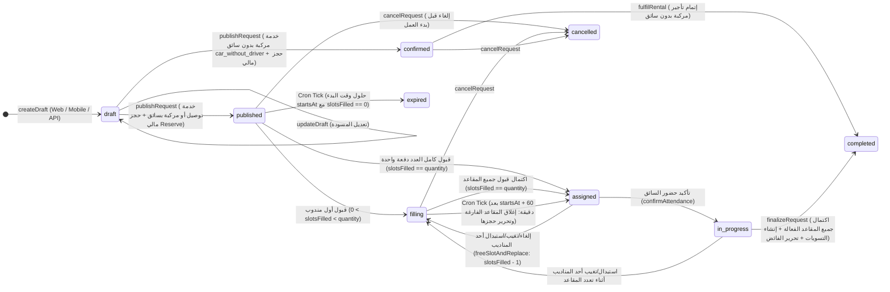
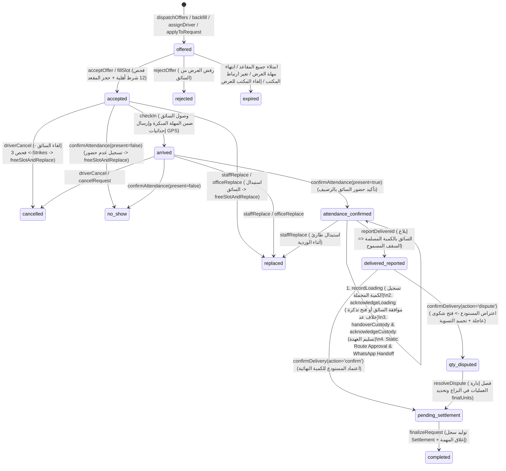
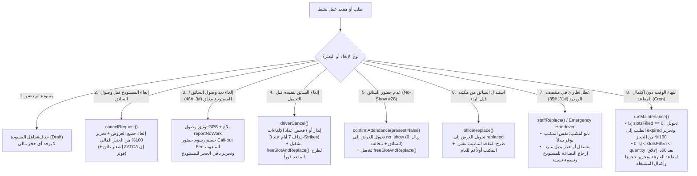

# الموسوعة المرجعية الشاملة لمنصة JR Logistics: الحقول، آلات الحالة (State Machines)، والتدفقات التفصيلية الكاملة للنظام

> **حالة الوثيقة:** النسخة الموسعة والكاملة للمراجعة والاعتماد — تغطي **100% من التدفقات البرمجية والتشغيلية والمالية** الموجودة في النظام ([`web/src/server/`](file:///Users/dogorshom/Desktop/Thawani/jr-logisitics/jr-logistics/web/src/server)) مدمجاً معها **الـ 78 سيناريو تشغيلي** وجميع **التعديلات المخصصة المعتمدة** من إدارة العمليات اللوجستية.

> **تحديث L (2026-11-22) — تنبيه مهم:** هذه الوثيقة مواصفة مستهدفة وليست وصفاً لما يعمل فعلاً، وعبارة «تغطي 100% من الكود» أعلاه غير دقيقة. أظهرت مراجعة K أن: (1) نحو 20 حقلاً مذكوراً هنا **غير موجود** في قاعدة البيانات (مثل `billing_model` و`billing_cycle` و`grace_period_days` و`agreed_package_specs` و`approved_zones` و`zone_mismatch_penalty_cents` و`occupancy_reservation_fee_cents` و`dock_delay_*` و`tga_license_number` و`replacement_sla_mins` و`max_package_capacity` و`extra_units_accepted` و`static_route_approved_at` و`national_address_short` و`geofence_radius_meters` و`ops_contact_phone`)، فالقسم الخامس لم يُنفَّذ. (2) **لا رسوم**: رسوم الحضور (50 ريال) وأجرة الانتظار (35 ريال/ساعة) ورسوم النطاق والغرامات **غير مطبَّقة — المبالغ بانتظار المالك**. (3) تسجيل الدخول **باسم المستخدم وكلمة المرور** لجميع الأدوار وليس برمز SMS، ورقم الجوال غير موثَّق. (4) الدفع عند الاستلام (COD) **مفعَّل** ونقاط البيع (POS) خارج النطاق. (5) تحسين المسار **متوقف افتراضياً**. (6) لا يوجد تأكيد/نزاع كمية من المستودع ولا مراجعة/اعتماد مالي: يُؤكَّد التسليم تلقائياً وتُدفع المستحقات فوراً. (7) الفوترة تُحتسب على الكمية المحجوزة والمحمّلة كحد أقصى (وليس «فوترة 75 وحدة»). (8) أُضيف: شحن المحفظة بالبطاقة (PayTabs) وبالتحويل البنكي، حدود مخاطر النقد للسائقين، التسليم عند إيقاف SMS، تصدير/حذف البيانات الشخصية، إعادة قبول الشروط، وإلزام تحديث التطبيق. **المرجع الأصح:** النسخة الإنجليزية `PLATFORM_FULL_SPEC_AND_FLOWS_EN.md` (ملاحظات «Update L») و`DECISIONS.md` (السلسلة L1–L16) و`TRACEABILITY.md`.

---

## الفهرس العام للوثيقة

1. **القسم الأول:** الحقول الكاملة المطلوبة لإضافة واعتماد المستودع (`Warehouse / Business Onboarding & Contract Fields`)
2. **القسم الثاني:** الحقول الكاملة المطلوبة للتعامل مع مكاتب التوصيل والمناديب والمركبات (`Courier Office, Agreements & Fleet Fields`)
3. **القسم الثالث:** التشريح الهندسي والتشغيلي الكامل لتدفق الطلب (`The Complete Multi-Layered Order Flow`) — يشمل:
   * **3.1** هيكلية آلات الحالة المتداخلة (`Parent Request [9 States]` × `Child Offer/Slot [13 States]` × `Custody [5 States]` × `Settlement [6 States]`)
   * **3.2** الفروقات الجوهرية بين أنواع الخدمات الثلاث (`delivery_driver` مقابل `car_with_driver` مقابل `car_without_driver`)
   * **3.3** المراحل التسع المتسلسلة لدورة حياة الطلب (من التسعير والحجز وحتى التسوية والفوترة)
   * **3.4** تدفقات الطلب المكتمل التفصيلية (**5 مسارات مكتملة مختلفة**)
   * **3.5** تدفقات الطلب الملغى التفصيلية (**8 مسارات إلغاء واستبدال مختلفة**)
   * **3.6** تدفقات الطلب المرتجع والرجيع العكسي `RTO` (**8 مسارات إرجاع وعهدة مختلفة**)
4. **القسم الرابع:** الدليل الشامل لجميع تدفقات المنصة (`All 32 End-to-End Platform Workflows`) موزعة على 7 وحدات منظومية:
   * **الوحدة A:** تدفقات الهوية، الدخول، الأمان، والتحقق الثنائي (`Auth, OTP, Staff MFA & Security Flows` — التدفقات 1 إلى 4)
   * **الوحدة B:** تدفقات التسجيل، التوثيق، ومراقبة الوثائق (`Onboarding, KYC & Document Guard Flows` — التدفقات 5 إلى 8)
   * **الوحدة C:** تدفقات مكاتب التوصيل، العقود، وربط الأسطول (`Courier Office, Invites & Fleet Management Flows` — التدفقات 9 إلى 12)
   * **الوحدة D:** تدفقات التسعير، المطابقة الذكية، والتوزيع (`Pricing Engine, Smart Matching & Dispatch Flows` — التدفقات 13 إلى 17)
   * **الوحدة E:** تدفقات الميدان، العهدة، التذاكر، والشكاوى (`Field Execution, Custody, Tickets & Disputes Flows` — التدفقات 18 إلى 22)
   * **الوحدة F:** تدفقات المحفظة السالبة، التسويات، الرقابة الثنائية، السحوبات، وفواتير ZATCA (`Finance, Negative Wallet, Settlements & ZATCA Flows` — التدفقات 23 إلى 28)
   * **الوحدة G:** تدفقات الربط الخارجي، الـ Webhooks، والمهام المجدولة الآلية (`External API, Webhooks, Cron Maintenance & Ops Flows` — التدفقات 29 إلى 32)

---

## القسم الأول: الحقول المطلوبة لإضافة واعتماد المستودع (`Warehouse / Business Onboarding Fields`)

يمثل المستودع (`role = 'business'`) العميل الرئيسي طالب الخدمة. تتوزع حقوله في قاعدة البيانات عبر جداول [`users`](file:///Users/dogorshom/Desktop/Thawani/jr-logisitics/jr-logistics/web/src/db/schema.ts#L22-L48)، [`businessProfiles`](file:///Users/dogorshom/Desktop/Thawani/jr-logisitics/jr-logistics/web/src/db/schema.ts#L50-L71)، [`walletAccounts`](file:///Users/dogorshom/Desktop/Thawani/jr-logisitics/jr-logistics/web/src/db/schema.ts#L395-L406)، و[`documents`](file:///Users/dogorshom/Desktop/Thawani/jr-logisitics/jr-logistics/web/src/db/schema.ts#L141-L157).

### 1.1 بيانات الحساب والتمثيل الرسمي (`users`)
| اسم الحقل البرمجي | التسمية بالعربية | النوع والقيود | إلزامي؟ | قواعد التحقق والعمل (`Validation & Logic`) |
| :--- | :--- | :--- | :---: | :--- |
| `id` | المعرف الفريد للمستودع | `UUID (PK)` | تلقائي | يُولد تلقائياً عند التسجيل |
| `role` | نوع الحساب | `'business'` | ثابت | يحدد صلاحيات بوابة المستودع |
| `name` | اسم الشخص المسؤول / المفوض | `Text (2–100 chars)` | نعم | يُخزن أيضاً في `business_profiles.responsible_person` |
| `phone` | رقم الجوال الرسمي | `Text (Unique, E.164)` | نعم | يطبع بصيغة `+9665XXXXXXXX` ويوثق عبر `OTP` قبل إنشاء الحساب |
| `email` | البريد الإلكتروني الرسمي | `Text (Unique, Lowercase)` | نعم | لإرسال الفواتير الضريبية `ZATCA` وإشعارات الحساب |
| `city` | المدينة الرئيسية للمستودع | `Text` | نعم | يجب أن تكون ضمن المدن المفعلة في `settings.cities` (`pickup = true`) |
| `language` | لغة الاستخدام والاتصال | `'ar' \| 'en' \| 'ur'` | نعم | الافتراضي `'ar'` |
| `status` | حالة الحساب العامة | `'active' \| 'suspended'` | تلقائي | إذا تحول إلى `suspended` تُلغى جميع الجلسات النشطة فوراً |

### 1.2 البيانات القانونية والتجارية والعنوان الوطني (`business_profiles`)
| اسم الحقل البرمجي | التسمية بالعربية | النوع والقيود | إلزامي؟ | قواعد التحقق والعمل (`Validation & Logic`) |
| :--- | :--- | :--- | :---: | :--- |
| `company_name` | الاسم التجاري الرسمي (عربي/إنجليزي) | `Text (2–150 chars)` | نعم | مطابق للسجل التجاري؛ يظهر في الفواتير الضريبية والتقارير |
| `cr_number` | رقم السجل التجاري / الرقم الموحد | `Text (10 digits)` | نعم | يبدأ بـ `1010` أو `700`؛ يُراجع من قسم التوثيق (`hr_verification`) |
| `tax_number` | الرقم الضريبي (`VAT Number`) | `Text (15 digits)` | نعم | يبدأ وينتهي بـ `3`؛ إلزامي لإصدار الفواتير الضريبية (`ZATCA Phase 2`) |
| `industry` | القطاع التجاري / النشاط | `Text (max 80 chars)` | نعم | أغذية، صيدليات، إلكترونيات، تجزئة، جملة (`B2B`)، قطع غيار، إلخ |
| `address` | العنوان التفصيلي للمستودع | `Text (max 250 chars)` | نعم | يشمل الحي، الشارع، رقم المبنى، والرمز المختصر للعنوان الوطني |
| `national_address_short` | الرمز المختصر للعنوان الوطني *(مضاف)* | `Text (8 chars)` | نعم | 4 أحرف + 4 أرقام (مثل `RRRD2929`) |
| `warehouse_lat` & `warehouse_lng` | إحداثيات بوابة التحميل (`GPS`) *(مضاف)* | `Double Precision` | نعم | الإحداثيات المرجعية لفحص السياج الجغرافي `500m Geofence` عند تحضير السائق |
| `geofence_radius_meters` | نصف قطر السياج الجغرافي *(مضاف)* | `Integer` | نعم | الافتراضي `500` متر |
| `responsible_person` | اسم مشرف التشغيل والرصيف | `Text` | نعم | يظهر لفريق العمليات للتنسيق اليومي |
| `ops_contact_phone` | جوال مشرف رصيف التحميل *(مضاف)* | `Text (E.164)` | نعم | للتواصل المباشر عند وصول المركبات للبوابة |
| `verification_status` | حالة توثيق المستودع | `'pending' \| 'verified' \| 'rejected' \| 'info_requested' \| 'suspended'` | تلقائي | لا يمكن نشر أي طلب (`publishRequest`) إذا كان `requireBusinessVerification = true` والحالة غير `verified` |
| `verification_note` | ملاحظة المراجع عند الرفض/طلب الاستكمال | `Text` | مشروط | إلزامي إذا كانت المراجعة `reject` أو `request_info` أو `suspend` |
| `rating_sum` & `rating_count` | مجموع وعدد تقييمات السائقين للمستودع | `Integer` | تلقائي | يُحدث تلقائياً عندما يقيم السائق المستودع بعد إغلاق المهمة (`1–5 نجوم`) |

### 1.3 المستندات الثبوتية للمستودع (`documents` — `owner_kind = 'business'`)
* `business_cr` (**إلزامي**): صورة السجل التجاري ساري المفعول (`PDF / JPG / PNG / WEBP` بحد أقصى `8 MB` مع فحص البصمة الثنائية للملف `Magic Bytes`).
* `tax_certificate` (**إلزامي للفوترة الآجلة**): شهادة التسجيل في ضريبة القيمة المضافة (`ZATCA`).
* `national_address_cert` (**إضافي موصى به**): شهادة العنوان الوطني المعتمدة.

### 1.4 حقول المحفظة السالبة والائتمان (`wallet_accounts` + `business_profiles`)
| اسم الحقل البرمجي | التسمية بالعربية | النوع والقيود | القاعدة المحاسبية والائتمانية |
| :--- | :--- | :--- | :--- |
| `billing_model` | نظام المحاسبة المالية *(مضاف)* | `'prepaid' \| 'postpaid_credit'` | مسبق الدفع أو آجل بمحفظة سالبة |
| `credit_limit_cents` | سقف الحد الائتماني السالب *(مضاف)* | `Integer (>= 0)` | مثلاً `5000000` هللة (`50,000 SAR`). يسمح للرصيد بالنزول حتى `-credit_limit_cents` |
| `available_cents` | الرصيد المتاح الحالي | `Integer` | يتحرك بالسالب عند الدفع الآجل؛ القيد: `available_cents - reserved_cents >= -credit_limit_cents` |
| `reserved_cents` | إجمالي المبالغ المحجوزة (`Escrow`) | `Integer (>= 0)` | يُحجز عند نشر الطلب (`publishRequest`) ويُحرر الفائض لحظياً عند انتهاء التحميل أو الإغلاق أو الإلغاء |
| `billing_cycle` | دورة الفوترة والسداد *(مضاف)* | `'weekly' \| 'net_15' \| 'net_30'` | موعد استحقاق سداد الرصيد السالب |
| `grace_period_days` | مهلة السماح قبل الإيقاف الآلي *(مضاف)* | `Integer (Default: 5)` | بعد انتهاء المهلة دون سداد، يُفعل `Automated Credit Lockout` (سيناريو #68) |

### 1.5 حقول الاتفاقية التشغيلية والغرامات التعاقدية للمستودع (`Contractual SLA Fields`)
> **تنفيذاً للقرارات المخصصة المعتمدة من إدارة العمليات (#1، #6، #9، #42):**
* `agreed_package_specs` (`JSONB` — **قرار #9**): مواصفات وأحجام وأوزان الطرود المتفق عليها مسبقاً في عقد المستودع (حيث **لا يتم إدخال الوزن والحجم لكل شحنة** أثناء إنشاء الطلب).
* `approved_zones` (`Text[]` — **قرار #42**): الزونات الجغرافية المعتمدة للمستودع حسب تقسيم زونات JR.
* `zone_mismatch_penalty_cents` (`Integer` — **قرار #42**): غرامة مالية تُفرض على المستودع عند اكتشاف شحنة خارج الزون المتفق عليه (مع إرجاع الشحنة للمستودع).
* `loading_grace_period_mins` (`Integer` — **قرار #6**): مهلة الانتظار والتحميل المجانية في الرصيف (الافتراضي `60 دقيقة`).
* `dock_delay_strikes` & `dock_delay_penalty_cents` (`Integer` — **قرار #6**): عداد تكرار تأخير السائقين في الرصيف لأكثر من 60 دقيقة والغرامة المالية المترتبة على التكرار (مع تمديد SLA المندوب).
* `unreadiness_strikes_weekly` & `occupancy_reservation_fee_cents` (`Integer` — **قرار #1**): عداد عدم جاهزية كامل الشحنات في الرصيف؛ إذا تجاوز **مرتين أسبوعياً**، تُخفض أولوية رصيف المستودع في المطابقة وتُفرض رسوم حجز إشغال.
* `callout_cancel_fee_cents` (`Integer` — **سيناريو #3 و #46**): رسوم تعويض حضور السائق (`Show-up Fee`) في حال إلغاء الطلب بعد وصول السائق للرصيف أو إغلاق المستودع.
* `webhook_url` & `webhook_secret` (`Text`): رابط استلام أحداث الطلب المباشرة وتوقيع `HMAC-SHA256` مع حماية كاملة ضد `SSRF / DNS Rebinding`.

---

## القسم الثاني: الحقول المطلوبة للتعامل مع مكاتب التوصيل (`Courier Office & Fleet Fields`)

يمثل مكتب التوصيل (`role = 'office'`) شريك الأسطول الذي يدير مجموعة مناديب ومركبات ويستلم التسويات المالية نيابةً عنهم. تتوزع حقوله في [`officeProfiles`](file:///Users/dogorshom/Desktop/Thawani/jr-logisitics/jr-logistics/web/src/db/schema.ts#L73-L92)، [`officeAgreements`](file:///Users/dogorshom/Desktop/Thawani/jr-logisitics/jr-logistics/web/src/db/schema.ts#L129-L139)، [`officeInvites`](file:///Users/dogorshom/Desktop/Thawani/jr-logisitics/jr-logistics/web/src/db/schema.ts#L117-L127)، و[`driverProfiles`](file:///Users/dogorshom/Desktop/Thawani/jr-logisitics/jr-logistics/web/src/db/schema.ts#L94-L115).

### 2.1 بيانات المكتب القانونية والمالية (`office_profiles`)
| اسم الحقل البرمجي | التسمية بالعربية | النوع والقيود | إلزامي؟ | قواعد التحقق والعمل (`Validation & Logic`) |
| :--- | :--- | :--- | :---: | :--- |
| `user_id` | المعرف الفريد للمكتب | `UUID (PK, FK -> users.id)` | تلقائي | مرتبط بحساب مستخدم بدور `'office'` |
| `office_name` | الاسم التجاري لمكتب التوصيل | `Text (2–150 chars)` | نعم | يظهر في الفواتير ولوحة العمليات والمناديب المرتبطين |
| `cr_number` | رقم السجل التجاري للمكتب | `Text (10 digits)` | نعم | إلزامي للتوثيق |
| `tga_license_number` | رقم ترخيص الهيئة العامة للنقل (`TGA`) *(مضاف)* | `Text` | نعم | يوثق عبر مستند `office_license` |
| `tax_number` | الرقم الضريبي للمكتب (`VAT Number`) | `Text (15 digits)` | نعم | للتسويات الضريبية والفواتير |
| `city` | المدينة الرئيسية للمكتب | `Text` | نعم | ضمن المدن المعتمدة في المنصة |
| `address` | العنوان الوطني لمقر المكتب | `Text` | نعم | للمراسلات القانونية |
| `responsible_person` | اسم مدير المكتب / مسؤول الحركة | `Text` | نعم | المسؤول عن إدارة الأسطول والاستبدال الطارئ |
| `bank_name` | اسم البنك المعتمد | `Text` | نعم | لصرف دفعات التسويات والسحوبات |
| `iban` | رقم الآيبان البنكي (`SA + 22 digits`) | `Text (24 chars)` | نعم | يُفحص برمجياً بالتعبير النمطي `/^SA\d{22}$/`؛ لا يُسمح بالسحب بدونه |
| `verification_status` | حالة توثيق المكتب | `'pending' \| 'verified' \| 'rejected' \| 'info_requested' \| 'suspended'` | تلقائي | **شرط الجاهزية (`readyOfficeIds`):** لا يمكن للمكتب أو مناديبه العمل إلا إذا كان `users.status = 'active'` و `verification_status = 'verified'` ولديه عقد ساري المفعول `office_agreements.status = 'accepted'` |

### 2.2 المستندات الإلزامية للمكتب (`documents` — `owner_kind = 'office'`)
* `office_cr` (**إلزامي**): السجل التجاري للمكتب.
* `office_license` (**إلزامي**): ترخيص الهيئة العامة للنقل (`TGA`).
* `iban_certificate` (**اختياري/موصى به**): شهادة الآيبان البنكي المصدقة.

### 2.3 حقول الاتفاقيات التجارية مع المكتب (`office_agreements`)
| اسم الحقل البرمجي | التسمية بالعربية | النوع والقيود | القاعدة التشغيلية والقانونية |
| :--- | :--- | :--- | :--- |
| `version` | رقم إصدار الاتفاقية | `Integer (Auto-increment per office)` | عند إصدار اتفاقية جديدة، تتحول أي اتفاقية سابقة إلى `superseded` |
| `status` | حالة الاتفاقية | `'pending_acceptance' \| 'accepted' \| 'superseded' \| 'expired'` | يجب على المكتب الضغط على قبول (`POST /office/agreements/:id/accept`) لتفعيل أسطوله |
| `terms` | نص الشروط والأحكام واتفاقية مستوى الخدمة | `Text (up to 10,000 chars)` | يتضمن التزام المكتب بتوفير بديل من نفس المكتب عند الأعطال (**قرار #31**) |
| `replacement_sla_mins` | مهلة توفير المندوب البديل *(مضاف)* | `Integer (Default: 45)` | المهلة القصوى للمكتب لإرسال مركبة بديلة عند تعطل أحد مناديبه في الميدان |
| `effective_at` & `expires_at` | تاريخ السريان وتاريخ الانتهاء | `Timestamp` | إذا حل تاريخ `expires_at`، يتوقف أسطول المكتب آلياً عن تلقي الفرص حتى تجديد العقد |
| `created_by` & `accepted_at` | منشئ العقد وتاريخ قبول المكتب | `UUID / Timestamp` | يُوثق في سجل التدقيق الجنائي `audit_logs` |

### 2.4 حقول المناديب والمركبات والربط بالمكتب (`driver_profiles` & `office_invites`)
| اسم الحقل البرمجي | التسمية بالعربية | النوع والقيود | القاعدة التشغيلية المرتبطة |
| :--- | :--- | :--- | :--- |
| `office_id` | معرف المكتب التابع له المندوب | `UUID (Nullable)` | `NULL` = مندوب مستقل (`Freelancer`)؛ `UUID` = مندوب تابع لمكتب |
| `office_link_status` | حالة الارتباط بالمكتب | `'direct' \| 'linked'` | عند انضمام المندوب لمكتب أو فك ارتباطه، يتم فوراً إنهاء جميع العروض المفتوحة غير المقبولة (`dropStaleOffers`) لضمان توجيه التسوية للطرف الصحيح |
| `national_id` | رقم الهوية الوطنية / الإقامة | `Text (10 digits)` | بيانات حساسة لا يراها إلا الموظفون المصرح لهم بـ `drivers.sensitive` |
| `vehicle_type` | نوع المركبة | `'sedan' \| 'dokker' \| 'hiace' \| 'van' \| 'dyna'` | يحدد الفرص المتاحة للمندوب |
| `vehicle_temperature` | درجة حرارة المركبة (للفان والدينا) | `'dry' \| 'cold' \| null` | إلزامي إذا كانت المركبة `van` أو `dyna` |
| `vehicle_plate` | رقم لوحة المركبة | `Text` | للتوثيق الأمني وتصاريح البوابات |
| `max_package_capacity` | السعة القصوى الاستيعابية للطرود *(مضاف)* | `Integer` | لتحديد إمكانية قبول طرود إضافية في الرصيف (**قرار سيناريو #2**) |
| `services` | الخدمات المؤهل لها السائق | `Text[]` | `['delivery_driver', 'car_with_driver']` |
| `availability` | حالة التفرغ الحالية | `'available' \| 'unavailable'` | عند التحول إلى `available`، يشغل النظام `backfillOffersForDriver` لإرسال الفرص المفتوحة له فوراً |
| `verification_status` | حالة توثيق وثائق السائق | `'pending' \| 'verified' \| 'rejected' \| 'expired'` | **مشتقة آلياً (`recomputeDriverVerification`):** يجب أن تكون الهوية (`national_id`)، الرخصة (`driving_license`)، والاستمارة (`vehicle_registration`) كلها `approved` وغير منتهية الصلاحية |
| `suspended_until` & `strikes_reset_at` | تاريخ انتهاء الإيقاف المؤقت وتصفير المخالفات | `Timestamp (Nullable)` | عند الإيقاف التلقائي (`3-Strikes`) يُضبط `suspended_until` لمدة 7 أيام، ويمكن للإدارة تصفيره يدوياً عبر `clearSuspension` (**قرار #29**) |

---

## القسم الثالث: التشريح الهندسي والتشغيلي الكامل لتدفق الطلب (`The Complete Multi-Layered Order Flow`)

> **لماذا تدفق الطلب في منصة JR Logistics معقد ومتعدد الطبقات؟**
> لأن الطلب الواحد (`Request`) ليس سجلًا بسيطًا، بل هو **مظلة تشغيلية ومالية** تنشئ تحتها مقعدًا أو عدة مقاعد عمل (`Offers / Job Slots` من 1 إلى 500 مركبة)، ولكل مقعد دورة حياة مستقلة، ومحضر تحميل مستقل، وعهدة مستقلة (`Custody Items`)، ونزاعات مستقلة، وتسوية مالية مستقلة (`Settlement`)، بينما يظل الطلب الأب يراقب اكتمال أو تعثر جميع المقاعد ليقرر متى يتحول من `published` إلى `filling` ثم `assigned` ثم `in_progress` ثم `completed`!

---

### 3.1 آلات الحالة المتداخلة الأربع (`The 4 Interlocking State Machines`)

#### أ) آلة حالة الطلب الأب (`Parent Request State Machine` — 9 حالات)

#### ب) آلة حالة عرض/مهمة المندوب (`Child Offer / Job Slot State Machine` — 13 حالة)

---

### 3.2 الفروقات الجوهرية بين أنواع الخدمات الثلاث في المنصة

يدعم النظام في [`catalog.ts`](file:///Users/dogorshom/Desktop/Thawani/jr-logisitics/jr-logistics/web/src/server/catalog.ts#L14-L18) ثلاث خدمات لوجستية يختلف سلوك تدفق الطلب في كل منها:

| وجه المقارنة | 1. مندوب توصيل (`delivery_driver`) | 2. مركبة مع سائق (`car_with_driver`) | 3. مركبة بدون سائق (`car_without_driver`) |
| :--- | :--- | :--- | :--- |
| **وحدة التسعير (`unit`)** | بالشحنة / الطرد (`shipment`) | باليوم لكل مركبة (`vehicle_day`) | باليوم لكل مركبة (`vehicle_day`) |
| **حساب الوحدات المتوقعة (`expectedUnits`)** | `shipmentsPerDriver` (عدد الشحنات لكل سائق) | `durationDays` (عدد أيام الإيجار: 1 إلى 90 يوماً) | `durationDays` (عدد أيام الإيجار: 1 إلى 90 يوماً) |
| **إجمالي الحجز المالي (`totalCents`)** | `priceCents × quantity × shipmentsPerDriver` | `priceCents × quantity × durationDays` | `priceCents × quantity × durationDays` |
| **الحالة بعد النشر (`publishRequest`)** | `published` ثم يوزع على المناديب (`dispatchOffers`) | `published` ثم يوزع على المناديب (`dispatchOffers`) | `confirmed` مباشرة (بدون توزيع مناديب `driverless = true`) |
| **خطوة عد التحميل (`recordLoading`)** | **إلزامية** (مع إقرار السائق `acknowledgeLoading`) | غير مطلوبة (`hasShipments = false`) | غير مطلوبة (`driverless = true`) |
| **طريقة الإغلاق النهائي** | تسليم الشحنات ➔ تأكيد المستودع ➔ تسوية لكل سائق | انتهاء أيام العمل ➔ إبلاغ السائق ➔ تأكيد المستودع ➔ تسوية | تنفيذ مباشر من موظف العمليات عبر `POST /admin/requests/:id/fulfil-rental` |

---

### 3.3 المراحل التسع المتسلسلة لدورة حياة الطلب (بأدق التفاصيل البرمجية والتشغيلية)

#### المرحلة (1): التسعير وحساب العرض المالي (`Pricing Resolution & Live Estimate`)
* **المسار البرمجي:** `POST /api/v1/requests/estimate` ➔ [`resolveRule()`](file:///Users/dogorshom/Desktop/Thawani/jr-logisitics/jr-logistics/web/src/server/pricing.ts#L24-L41).
* **خوارزمية أولوية التسعير (`Specificity Hierarchy`):**
  1. يبحث النظام في جدول `pricing_rules` عن القواعد المعتمدة (`status = 'approved'`) والسارية زمنياً (`effective_at <= now < expires_at`).
  2. **الأولوية الأولى:** القاعدة المخصصة لهذا المستودع بعينه (`business_id = user.id`) تغلب دائماً القاعدة العامة (`business_id IS NULL`).
  3. **الأولوية الثانية:** القاعدة الأكثر تحديداً في الأبعاد الأربعة (`vehicle_type`, `temperature`, `pickup_city`, `delivery_city`) تغلب القاعدة ذات الحقول الفارغة (`Wildcards`).
  4. **الأولوية الثالثة:** أعلى إصدار (`version DESC`) ثم الأحدث تاريخاً (`effective_at DESC`).
* **حماية سرية الهامش:** يعيد النظام للمستودع `publicQuote` (سعر الوحدة للعميل والإجمالي فقط) ولا يكشف أبداً تكلفة المزود (`providerCostCents`) أو هامش المنصة (`marginCents`).

#### المرحلة (2): إنشاء المسودة والنشر والحجز المالي (`Draft Creation, Publishing & Escrow Reserve`)
* **المسار البرمجي:** `POST /api/v1/requests` أو `POST /api/v1/requests/:id/publish` ➔ [`publishRequest()`](file:///Users/dogorshom/Desktop/Thawani/jr-logisitics/jr-logistics/web/src/server/requests.ts#L112-L151).
* **بوابات الفحص الصارمة قبل النشر (`Publish Gates`):**
  1. قفل صف الطلب في قاعدة البيانات (`SELECT ... FOR UPDATE`) لمنع النشر المزدوج.
  2. التحقق من قبول الشروط (`termsAccepted = true`) وتسجيل بصمة القبول في `terms_consents`.
  3. التحقق من أن حساب المستودع موثق (`verification_status = 'verified'`).
  4. التحقق من أن وقت البدء `startsAt` في المستقبل، وأن عنواني الاستلام والتسليم مكتملان.
  5. **تنفيذاً لقرار #47:** إلغاء خاصية `preferredOfficeId` (عدم حصر الطلب بمكتب مفضل).
  6. **تنفيذاً لقرار #48:** حفظ خيار المستودع لطلبات المركبات المتعددة (`slot_acceptance_mode`: `'all_or_nothing'` أو `'allow_partial'`).
  7. **الحجز المالي الذري (`Atomic Escrow Reserve`):** خصم `totalCents` من `available_cents` (ضمن سقف المحفظة السالبة `-credit_limit_cents`) وإضافته إلى `reserved_cents` بمفتاح عدم تكرار `reserve:{requestId}`، وتجميد نسخة التسعير في `pricing_snapshot`.

#### المرحلة (3): محرك المطابقة الذكية وتوزيع العروض (`Smart Matching, 12 Guards & Offer Dispatch`)
* **المسار البرمجي:** [`evaluateCandidates()`](file:///Users/dogorshom/Desktop/Thawani/jr-logisitics/jr-logistics/web/src/server/matching.ts#L51-L93) & [`dispatchOffers()`](file:///Users/dogorshom/Desktop/Thawani/jr-logisitics/jr-logistics/web/src/server/matching.ts#L113-L130).
* **موانع الأهلية الـ 12 الصارمة (`12 Hard Eligibility Guards` — لا يتجاوزها أي تقييم):**
  1. `not_verified`: وثائق السائق غير مكتملة أو منتهية الصلاحية.
  2. `unavailable`: السائق في حالة غير متاح (`unavailable`).
  3. `suspended`: السائق موقوف مؤقتاً (`suspended_until > now`).
  4. `service_mismatch`: الخدمة غير مدرجة في خدمات السائق.
  5. `vehicle_mismatch`: نوع مركبة السائق لا يطابق المركبة المطلوبة في الطلب.
  6. `temp_mismatch`: درجة تبريد المركبة (`dry`/`cold`) لا تطابق المطلوب (للفان والدينا).
  7. `city_mismatch`: مدينة السائق لا تطابق مدينة الاستلام (`pickup_city`).
  8. `office_ineligible`: السائق مرتبط بمكتب غير موثق أو لم يقبل الاتفاقية التجارية.
  9. `already_offered`: تم إرسال عرض سابق لنفس السائق على نفس الطلب.
  10. `time_overlap`: لدى السائق مهمة أخرى تتقاطع زمنياً مع نافذة الطلب (`startsAt` إلى `startsAt + durationDays`) أو سياسة المنصة تمنع أكثر من مهمة نشطة (`single_active`).
* **معادلة نقاط المفاضلة (`Explainable Candidate Score` — من 80 نقطة):**
  * النقاط الأساسية (`Base`): `+50 نقطة`
  * تقييم السائق (`Rating`): حتى `+20 نقطة` (`round(avgRating × 4)`)
  * الخبرة (`Experience`): حتى `+10 نقاط` (نقطة لكل مهمة مكتملة حتى 10)
  * خصم الإلغاءات الأخيرة (`Recent Cancellations Penalty`): `-3 نقاط` لكل إلغاء خلال نافذة المراقبة (بحد أقصى `-15 نقطة`).
* **قنوات إسناد المقاعد الأربعة (`4 Offer Creation Sources`):**
  1. `source = 'system'`: التوزيع الآلي عند النشر (لأفضل `openSlots × 5` مرشحين بحد أقصى 30) أو عبر `backfillOffersForDriver` فور تحول سائق متأهل إلى `available`.
  2. `source = 'apply'`: تقديم السائق المباشر من شاشة الفرص المفتوحة (`POST /driver/requests/:id/apply`).
  3. `source = 'office'`: إسناد مدير مكتب التوصيل للفرصة لأحد مناديبه المؤهلين (`POST /office/opportunities/:id/assign`).
  4. `source = 'manual'`: إسناد يدوي من موظف العمليات (`POST /admin/requests/:id/assign`) مع ذكر السبب.

#### المرحلة (4): قبول العرض وإدارة تعدد المقاعد (`Offer Acceptance & Multi-Slot Concurrency`)
* **المسار البرمجي:** `POST /api/v1/offers/:id/accept` ➔ [`fillSlot()`](file:///Users/dogorshom/Desktop/Thawani/jr-logisitics/jr-logistics/web/src/server/jobs.ts#L51-L83).
* **منع التضارب (`Deadlock-Free Serialization`):** يتم دائماً قفل صف الطلب الأب `requests` أولاً ثم صف العرض `offers` ثانياً.
* عند قبول السائق (أو المكتب):
  * يزيد عداد `slots_filled` بمقدار `+1` (أو بكامل العدد إذا كان القبول كحزمة `all_or_nothing`).
  * إذا كان `slots_filled < quantity`: تتحول حالة الطلب الأب إلى `filling` ويستمر باقي المناديب بقبول المقاعد المتبقية.
  * بمجرد وصول `slots_filled == quantity`: تتحول حالة الطلب الأب إلى `assigned`، وتنتهي صلاحية جميع العروض الأخرى المعلقة تلقائياً (`status = 'expired'`).

#### المرحلة (5): الوصول الجغرافي وتأكيد الحضور بالرصيف (`Check-in, Geofence & Attendance Confirmation`)
* **تسجيل وصول السائق (`POST /offers/:id/checkin`):**
  * يفتح باب تسجيل الوصول قبل موعد البدء بـ `checkinEarlyMin` (الافتراضي 60 دقيقة) وضمن سياج `500m GPS`.
  * تتحول حالة العرض إلى `arrived` وتُحفظ إحداثيات `arrived_lat`, `arrived_lng`, `arrived_at`.
* **قرار المستودع بشأن الحضور (`POST /offers/:id/attendance`):**
  * **إذا أكد المستودع حضور السائق (`present = true`):** تتحول حالة العرض إلى `attendance_confirmed`، وإذا كانت كل مقاعد الطلب مكتملة يتحول الطلب الأب إلى `in_progress`.
  * **إذا سجل المستودع عدم حضور السائق (`present = false` مع ذكر السبب):** تتحول حالة العرض إلى `no_show`، ويُستدعى فوراً [`freeSlotAndReplace()`](file:///Users/dogorshom/Desktop/Thawani/jr-logisitics/jr-logistics/web/src/server/jobs.ts#L169-L177) لإنقاص `slots_filled` وإعادة طرح المقعد لمناديب بدلاء تلقائياً.
* **بلاغ السائق "لم يتم تشغيلي" (`POST /offers/:id/no-work`):**
  * إذا وصل السائق للرصيف (`arrived` أو `attendance_confirmed`) وتجاهله المستودع أو لم يسلمه عملاً، يضغط "إبلاغ عن عدم وجود عمل" فيفتح النظام تذكرة عاجلة `not_put_to_work` لغرفة العمليات (سيناريو #3 و #57).

#### المرحلة (6): عد الشحنات في الرصيف، معالجة السعة، وتسليم العهدة (`Loading Bay Count, Extra Capacity & Custody`)
* **تسجيل الكمية المحملة (`POST /offers/:id/loading`):** يسجل مشرف المستودع عدد الطرود الفعلي `loaded_units`.
* **معالجة الحالات الثلاث للكمية المحملة:**
  1. **الكمية مطابقة للمتوقع (`loaded == expected`):** يقر السائق الكمية (`POST /offers/:id/loading-ack` بـ `ok = true`).
  2. **الكمية أقل من المتوقع (`loaded < expected` — سيناريو #1):** يقر السائق الكمية الفعلية الأقل، ويُسجل تكرار النقص على المستودع (أكثر من مرتين أسبوعياً يخفض أولوية الرصيف ويفرض رسوم حجز إشغال).
  3. **الكمية أكبر من المتوقع (`loaded > expected` — قرار سيناريو #2 المعتمد):**
     * يظهر للسائق خيار قبول الطرود الإضافية (بما لا يتجاوز `max_package_capacity` للمركبة) أو رفض الزيادة.
     * عند موافقة السائق (`ok = true` مع `extra_units_accepted = true`): يقوم النظام بزيادة `expected_units` للمقعد وحجز الفرق المالي الإضافي من المحفظة السالبة للمستودع بحيث **يحاسب المستودع ويكافأ السائق على كامل الطرود المحملة (مثلاً الـ 75 طرداً بالكامل)**.
  4. **اعتراض السائق على العد (`ok = false`):** إذا سجل المستودع 50 طرداً بينما عدّ السائق 45 طرداً فقط، يرفض السائق الإقرار (`loaded_ack_by_driver = false`) فيفتح النظام تلقائياً تذكرة `shipment_count_differs` ويمنع الانتقال لمرحلة التسليم حتى يُصحح الرقم.
* **تسليم العهدة المادية (`POST /offers/:id/custody` ➔ `POST /custody/:id/acknowledge`):**
  * يسجل المستودع أي عهدة مادية مرافقة (مثل حوافظ التبريد، الحقائب، الأقفال الذكية — مع إيقاف أجهزة الكاش والشبكة حسب قرار #23 و #24)، ويقر السائق باستلامها في التطبيق (`status = 'acknowledged'`).

#### المرحلة (7): اعتماد المسار الثابت، التواصل عبر واتساب، والتنفيذ الميداني (`Static Route, WhatsApp & Field Execution`)
* **اعتماد المسار الثابت (`POST /driver/route/optimize` — قرار #19):**
  * يولد النظام ترتيب نقاط التوقف الثابت (`Static Route` باستخدام خوارزمية `Nearest-Neighbor + 2-Opt`) ويعتمدها المندوب قبل الانطلاق دون إجباره على تغيير المسار ديناميكياً أثناء القيادة.
* **الربط الموثق مع واتساب (`GET /driver/jobs/:id/whatsapp`):**
  * يتيح التطبيق للسائق فتح محادثة واتساب مجهزة مسبقاً مع المستلم بثلاث لغات (`ar`, `en`, `ur`) وثلاثة قوالب (`contact`, `arriving`, `issue`) مع تسجيل الحدث `whatsapp_handoff_opened` في `job_events` كإثبات لمحاولة التواصل.
* **توثيق تعذر الوصول للمستلم (`POST /driver/jobs/:id/contact-exception`):**
  * يسجل السائق (`no_answer | wrong_number | refused | other`) بعد انتهاء مؤقت الانتظار الميداني (10 دقائق)، مما يفتح تذكرة متابعة ويوثق حق السائق في إرجاع الطرد (`RTO`).

#### المرحلة (8): الإبلاغ عن التسليم، فحص سقف الوحدات، وقرار المستودع أو النزاع (`Delivery Reporting & Dispute Gate`)
* **إبلاغ السائق بالكمية المسلمة (`POST /offers/:id/delivered`):**
  * يدخل السائق `delivered_units` (بشرط أن يكون قد أقر بكمية التحميل أولاً `loaded_ack_by_driver === true`، وألا يتجاوز العدد المحمل). تتحول حالة العرض إلى `delivered_reported`.
* **قرار المستودع النهائي (`POST /offers/:id/delivery-decision`):**
  * **الخيار أ — التأكيد (`action = 'confirm'`):** يعتمد المستودع `final_units`، وتتحول حالة العرض إلى `pending_settlement`، ويستدعي النظام `completeIfReady()`.
  * **الخيار ب — الاعتراض وفتح النزاع (`action = 'dispute'` — قرار #22 و #38):**
    * تتحول حالة العرض فوراً إلى `qty_disputed`.
    * ينشئ النظام شكوى رسمية عاجلة (`complaints` بـ `priority = 'urgent'` و **`holds_settlement = true`**) مما يمنع صرف التسوية المالية لهذا المقعد تحديداً حتى يفصل مشرف العمليات في النزاع عبر `POST /admin/offers/:id/resolve-dispute`.

#### المرحلة (9): الإغلاق النهائي للطلب، تحرير الحجز الفائض، وإنشاء التسويات (`Finalization & Escrow Release`)
* **الإغلاق التلقائي (`completeIfReady`) أو اليدوي للطلبات الجزئية (`POST /requests/:id/complete`):**
  * عندما تصل جميع المقاعد الفعالة في الطلب إلى `pending_settlement`:
  1. ينشئ النظام سجل تسوية (`createSettlement`) لكل مقعد عمل بشكل مستقل ومحصن ضد التكرار (`UNIQUE(offer_id)`).
  2. تتحول حالة كل عرض إلى `completed`، وتتحول أي عروض أخرى بقيت في حالة `offered` إلى `expired`.
  3. يحرر النظام أي مبالغ محجوزة لمقاعد لم تُشغل (`complete-release:{requestId}`).
  4. تتحول حالة الطلب الأب إلى `completed`، ويُتاح التقييم المتبادل (`POST /offers/:id/rate`) بين المستودع والسائق.

---

### 3.4 تدفقات الطلب المكتمل التفصيلية (`5 Completed Order Flow Variants`)

| المسار المكتمل | الوصف التشغيلي | تسلسل الحالات (`Request` / `Offer`) | المعالجة المالية في `settlements` و `wallet_accounts` |
| :--- | :--- | :--- | :--- |
| **1. المسار القياسي لتوصيل الطرود (100% تسليم)** | المستودع يطلب توصيل 50 طرداً ➔ السائق يحمل 50 ويسلم 50 طرداً بالكامل | `Request`: `draft -> published -> assigned -> in_progress -> completed` `Offer`: `offered -> accepted -> arrived -> attendance_confirmed -> delivered_reported -> pending_settlement -> completed` | • تحرير الحجز: `release_reserve = +50 × unitPrice` • خصم العميل: `charge = -50 × unitPrice` • دفع للمكتب/السائق: `payout = +50 × providerCost` • عمولة المنصة: `platform_fee = +50 × margin` • إصدار فاتورة `ZATCA` بـ 50 طرداً |
| **2. المسار المكتمل بتحميل جزئي أصلًا (سيناريو #1)** | المستودع حجز 50 طرداً، لكن عند وصول السائق للرصيف سلمه 30 طرداً فقط، وسلمها السائق بالكامل | نفس تسلسل الحالات مع `expected_units = 50` و `loaded_units = 30` و `final_units = 30` | • يُحاسب المستودع على 30 طرداً فقط (`customerCents = 30 × unitPrice`) • يعود فرق الـ 20 طرداً (`refundCents = 20 × unitPrice`) فوراً لرصيد المستودع المتاح • إذا تكرر النقص من المستودع > مرتين أسبوعياً: تُفرض رسوم حجز إشغال (`occupancy_reservation_fee`) وتنخفض أولوية الرصيف |
| **3. المسار المكتمل بطرود إضافية فوق المتوقع (قرار سيناريو #2)** | المستودع حجز 50 طرداً، وفي الرصيف طلب تحميل 75 طرداً ➔ السائق وافق ضمن سعة مركبته وسلم الـ 75 طرداً | عند `recordLoading(75)` وموافقة السائق `acknowledgeLoading(true)`: يرتفع سقف المقعد إلى `75` مع حجز مالي إضافي לـ 25 طرداً | • **تنفيذاً لقرار #2:** يُخصم من المستودع قيمة الـ **75 طرداً كاملة** (`75 × unitPrice`) • يُدفع للمندوب/المكتب أجر الـ **75 طرداً كاملة** (`75 × providerCost`) • تصدر الفاتورة الضريبية بالـ 75 طرداً |
| **4. مسار مركبة مع سائق بنظام اليومية (`car_with_driver`)** | المستودع يطلب مركبة دينا مبردة مع سائق لمدة 5 أيام (`durationDays = 5`) | لا يوجد عد طرود (`hasShipments = false`)؛ يوثق الحضور والانصراف وتُعتمد الأيام المنفذة (`finalUnits = 5 days`) | • المحاسبة باليوم (`unit = 'vehicle_day'`) • `customerCents = 5 days × dailyPrice` • `providerCents = 5 days × dailyProviderCost` |
| **5. مسار تأجير مركبة بدون سائق (`car_without_driver`)** | المستودع يطلب استئجار 3 مركبات فان بدون سائق لمدة 10 أيام | `Request`: `draft -> confirmed -> completed` (عبر `POST /admin/requests/:id/fulfil-rental` بدون عروض سائقين) | • يُحول كامل المبلغ المحجوز `reservedCents` عبر قيد `charge` من المستودع إلى إيرادات المنصة `platform_fee` وتصدر الفاتورة |

---

### 3.5 تدفقات الطلب الملغى والاستبدال التفصيلية (`8 Cancelled & Replacement Order Flows`)

---

### 3.6 تدفقات الطلب المرتجع والرجيع العكسي التفصيلية (`8 Returned Order / RTO Flows`)

في جميع حالات الإرجاع الميداني، يتم توثيق السبب بالوقت وإحداثيات الـ GPS في `job_events`، وتدخل الطرود غير المسلمة في ذمة السائق كعهدة مرتجعة واجبة التسليم للمستودع في نهاية الوردية:

| مسار الإرجاع (`RTO Scenario`) | الحدث المشغل في الميدان (`Trigger`) | الإجراء الإلزامي على السائق والنظام | المعالجة المالية والائتمانية والتأديبية |
| :--- | :--- | :--- | :--- |
| **1. العميل لا يرد / الهاتف مغلق (#14)** | وصول السائق لموقع العميل وتعذر التواصل | 1. البقاء في الموقع 10 دقائق (`GPS Timer`) 2. فتح رابط واتساب الرسمي `GET /whatsapp?kind=issue` 3. تسجيل `POST /contact-exception` (`no_answer`) 4. إعادة الطرد للمستودع في نهاية الوردية | يُحتسب الطرد ضمن الجهد المنفذ للسائق طالما التزم بمؤقت الانتظار وإثبات التواصل، ويُغلق محضر الرجيع عند استلام المستودع للطرد |
| **2. رفض العميل الاستلام عند الباب (#15)** | العميل يرفض استلام الشحنة دون عيب في التوصيل | تسجيل `POST /contact-exception` (`refused`) + إعادة الطرد للمستودع وتأكيد استلام مشرف الرصيف | يستحق السائق/المكتب أجر التوصيل لتحقق الوصول الفعلي، ولا يتحمل السائق وزر رفض العميل |
| **3. طلب العميل تغيير العنوان لمنطقة أخرى أثناء المسار (قرار #21)** | العميل يطلب توصيل الشحنة لحي آخر خارج المسار المعتمد | **قرار إداري حاسم (#21):** يمنع تحويل المسار؛ يسجل السائق الحالة ويحول الطرد مباشرة إلى **مرتجع للمستودع (`RTO`)** | يعود الطرد للمستودع لإعادة جدولته في طلب جديد بالزون الصحيح |
| **4. عنوان الشحنة خارج الزون المتفق عليه مع المستودع (قرار #42)** | اكتشاف أن العنوان الفعلي يقع خارج مضلع الزون المعلن من المستودع | **قرار إداري حاسم (#42):** يتم **إرجاع الشحنة إلى المستودع** مع تسجيل مخالفة تصنيف زون على المستودع | تُفرض **غرامة اختلاف الزون (`zone_mismatch_penalty_cents`)** على المحفظة السالبة للمستودع لتعويض السائق والمنصة |
| **5. غياب تصريح دخول البوابات الأمنية/الموانئ `Gate Pass` (قرار #54)** | منع السائق من دخول مجمع أمني/ميناء لعدم إرفاق المستودع لتصريح دخول | **قرار إداري حاسم (#54):** يتصل السائق بالعميل للحضور لاستلام الشحنة عند البوابة؛ وإذا رفض العميل **تُرجع الشحنة فوراً للمستودع** | يتحمل المستودع تكلفة المشوار لعدم توفير التصريح أو عدم حضور العميل للبوابة |
| **6. رفض شحنة/جهاز كبير لوجود تلف ظاهري (قرار #22)** | العميل يرفض استلام شحنة بدعوى وجود كسر أو تلف في الكرتون/الجهاز | تصوير الطرد في الموقع + إرجاعه للمستودع + فتح **شكوى/نزاع في المنصة (`fileComplaint` مع `holdsSettlement = true`)** | تُجمد تسوية هذه المهمة لحين مراجعة إدارة المنصة لصور ما قبل التحميل وما بعد الإرجاع وتحديد الطرف المتسبب |
| **7. إرجاع بسبب عطل مركبة أو ثلاجة تبريد في منتصف الوردية (قرار #31, #35)** | تعطل المركبة أثناء التوزيع | • **إذا كان السائق تابعاً لمكتب:** يرسل نفس المكتب مركبة بديلة لاستلام الطرود وإكمال توزيعها. • **إذا كان السائق مستقلاً (`Freelancer`) أو لم يتوفر بديل مبرد خلال المهلة:** تُرجع الطرود المتبقية فوراً للمستودع | في حال إرجاع المستقل للطرود المتبقية: تُسوى المهمة نسبياً (`Pro-rata`) على عدد الطرود التي سُلمت للعملاء فقط، ويُحرر باقي الحجز للمستودع |
| **8. تخلف السائق عن تسليم الطرود المرتجعة أو العهدة للمستودع (قرار #26)** | انتهاء الوردية وتسجيل المستودع `POST /custody/:id/return` بحالة `not_returned` أو نقص في الطرود المرتجعة | **قرار إداري حاسم (#26):** 1. تجميد جميع مستحقات السائق المالية فوراً (`holds_settlement = true`). 2. **إيقاف حساب السائق عن العمل فوراً من أول مرة (`status = 'suspended'`)** وإحالته لتحقيق المنصة | خصم قيمة البضاعة المفقودة من المستحقات المحتجزة للسائق/المكتب مع بقاء الحظر حتى قرار إدارة المنصة |

---

## القسم الرابع: الدليل الشامل لجميع تدفقات المنصة (`All 32 End-to-End Platform Workflows`)

فيما يلي جميع التدفقات الـ 32 الموجودة في المنصة موزعة على وحداتها السبع:

### الوحدة (A): تدفقات الهوية، الدخول، الأمان، والتحقق الثنائي (`Auth & Security Flows`)

1. **التدفق (1) — الدخول والتسجيل الموحد بالجوال (`Phone OTP Auth & Registration Token Flow`):**
   * `POST /auth/otp/send` (مع حماية `Rate Limit`: 3 رسائل كل 10 دقائق للجوال، وإخفاء هوية أرقام الموظفين لمنع كشفها) ➔ `POST /auth/otp/verify` (تشفير الرمز بـ `HMAC-SHA256` وبحد أقصى 5 محاولات).
   * إذا كان الرقم مسجلاً: تُنشأ جلسة (`Session` بمهلة 7 أيام للويب و30 يوماً للجوال).
   * إذا كان الرقم جديداً: يعيد النظام `registrationToken` صالحاً لمدة 15 دقيقة لإكمال التسجيل في `POST /auth/register`.
2. **التدفق (2) — دخول الموظفين والإدارة مع القفل التلقائي (`Staff Email/Password & Brute-Force Lockout Flow`):**
   * `POST /auth/staff/login`: يتحقق من البريد وكلمة المرور (`bcrypt`). عند فشل الدخول 5 مرات متتالية، يُقفل الحساب تلقائياً لمدة 15 دقيقة (`locked_until`)، ولا يمكن فتحه إلا بمرور الوقت أو عبر `POST /admin/staff/:id/unlock`.
3. **التدفق (3) — التحقق الثنائي للموظفين (`Staff TOTP MFA & Recovery Codes Flow`):**
   * `POST /auth/mfa/setup` ➔ `POST /auth/mfa/enable` (يولد 8 أكواد استرداد لمرة واحدة) ➔ عند الدخول يعيد النظام `mfaToken` مؤقتاً لمدة 5 دقائق لا يمنح جلسة إلا بعد نجاح `POST /auth/staff/login/mfa`.
4. **التدفق (4) — إدارة صلاحيات الموظفين ومنع تصعيد الصلاحيات (`RBAC & Anti-Privilege-Escalation Flow`):**
   * `POST /admin/staff` & `PATCH /admin/staff/:id`: يدعم 6 قوالب جاهزة (`support`, `operations`, `finance`, `hr_verification`, `account_manager`, `reports`) و34 صلاحية دقيقة. يطبق النظام قاعدة `assertGrantable`: لا يمكن لأي مشرف منح صلاحية لموظف آخر ما لم يكن هو نفسه يمتلكها، وعند تعديل صلاحيات موظف أو إيقافه تُلغى جميع جلساته فوراً (`revokeAllSessions`).

---

### الوحدة (B): تدفقات التسجيل، التوثيق، ومراقبة الوثائق (`Onboarding & Compliance Flows`)

5. **التدفق (5) — تسجيل وتوثيق المستودع (`Business Onboarding & Verification Flow`):**
   * تسجيل المستودع (`POST /auth/register` بدور `business`) ➔ إنشاء محفظة مالية تلقائياً (`ensureAccount`) ➔ رفع السجل التجاري والشهادة الضريبية (`POST /documents`) ➔ مراجعة الإدارة في طابور التوثيق (`GET /admin/verification-queue` ➔ `POST /admin/users/:id/verification` بقرار `verify | reject | request_info | suspend`) ➔ ضبط سقف المحفظة السالبة ومواصفات الطرود التعاقدية (#9).
6. **التدفق (6) — تسجيل وتوثيق مكتب التوصيل (`Courier Office Onboarding Flow`):**
   * تسجيل المكتب بدور `office` مع التحقق من صحة الآيبان السعودي (`SA + 22 digits`) ➔ رفع السجل التجاري وترخيص هيئة النقل `office_license` ➔ مراجعة الوثائق وتوثيق الحساب.
7. **التدفق (7) — فحص الملفات المرفوعة وحماية التخزين (`Secure Document Upload & Magic-Byte Inspection Flow`):**
   * `POST /documents`: يفحص النظام البصمة الثنائية (`Magic Bytes` في [`matchesMime()`](file:///Users/dogorshom/Desktop/Thawani/jr-logisitics/jr-logistics/web/src/server/accounts.ts#L201-L210)) للتأكد من أن الملف حقيقي (`PDF/JPEG/PNG/WEBP`) وليس ملفاً تنفيذياً متنكراً، ويتحقق من أن تاريخ الانتهاء `expiresOn` في المستقبل، ويحفظه بمفتاح عشوائي مع تسجيل كل عملية اطلاع على الوثيقة في `audit_logs`.
8. **التدفق (8) — الاحتساب الآلي المشتق لتوثيق السائقين (`Derived Driver Verification & Expiry Re-computation Flow`):**
   * [`recomputeDriverVerification()`](file:///Users/dogorshom/Desktop/Thawani/jr-logisitics/jr-logistics/web/src/server/accounts.ts#L253-L268): لا يُوثق السائق يدوياً بشكل منفصل عن وثائقه؛ كلما وُوفقت وثيقة (`reviewDocument`) أو انتهى تاريخ صلاحيتها في الفحص اليومي، يعيد النظام فحص الوثائق الإلزامية الثلاث (`national_id`, `driving_license`, `vehicle_registration`). إذا اكتملت وكانت سارية يصبح `verified`، وإذا انتهت إحداها يتحول فوراً إلى `expired` ويتوقف عن استقبال الطلبات (سيناريو #77).

---

### الوحدة (C): تدفقات مكاتب التوصيل، العقود، وربط الأسطول (`Office & Fleet Flows`)

9. **التدفق (9) — إصدار وقبول اتفاقيات مكاتب التوصيل (`Office Commercial Agreement Lifecycle Flow`):**
   * ينشئ موظف الإدارة اتفاقية جديدة للمكتب (`POST /admin/offices/:id/agreements`) فتلغي تلقائياً أي مسودة سابقة وتأخذ رقم إصدار جديد (`version + 1`) بحالة `pending_acceptance`.
   * يستعرض المكتب الاتفاقية ويقبلها إلكترونياً (`POST /office/agreements/:id/accept`) فيتحول العقد السابق إلى `superseded` ويصبح المكتب مؤهلاً للعمل (`ready = true`).
10. **التدفق (10) — دعوة المناديب للانضمام لمكتب توصيل (`Office Driver Invitation Flow`):**
    * يرسل المكتب الموثق دعوة برقم جوال السائق (`POST /office/drivers/invite`).
    * يتحقق النظام من أن الرقم لا يخص مستودعاً أو مكتباً، وأن السائق غير مرتبط بمكتب آخر.
    * إذا لم يكن السائق مسجلاً بعد، تبقى الدعوة معلقة على رقم جواله، وبمجرد تسجيله في المنصة تُربط الدعوة بحسابه تلقائياً!
11. **التدفق (11) — قبول/رفض السائق للدعوة وحماية التسويات (`Driver Invite Response & Stale Offer Purge Flow`):**
    * يستعرض السائق الدعوة (`GET /driver/invites`) ويرد عليها (`POST /driver/invites/:id/respond`).
    * **قاعدة أمان مالي حرجة:** يمنع النظام السائق من الانضمام لمكتب أثناء وجود مهمة نشطة بيده (`OFFER_BUSY`)، وبمجرد قبوله الانضمام، يلغي النظام فوراً جميع العروض المفتوحة غير المقبولة (`dropStaleOffers`) حتى لا تُسوى مهمة قديمة لحساب الطرف الخطأ.
12. **التدفق (12) — فك ارتباط السائق عن المكتب (`Driver Unlink by Office or Admin Flow`):**
    * `POST /office/drivers/:id/unlink` أو `POST /admin/drivers/:id/unlink-office`: بشرط عدم وجود مهمة جارية للسائق، يتحول السائق فوراً إلى مستقل (`office_id = null`, `office_link_status = 'direct'`) وتُلغى عروضه المعلقة ليبدأ باستلام أرباحه القادمة في محفظته الشخصية مباشرة.

---

### الوحدة (D): تدفقات التسعير، المطابقة الذكية، والتوزيع (`Pricing, Matching & Dispatch Flows`)

13. **التدفق (13) — إدارة قواعد التسعير وإحالة القواعد القديمة للتقاعد (`Pricing Rule Versioning & Retirement Flow`):**
    * `POST /admin/pricing`: عند إضافة قاعدة تسعير جديدة بنفس أبعاد قاعدة سابقة، لا تُمسح القاعدة القديمة (لأن الطلبات السابقة تحتفظ بنسختها)، بل تتحول القاعدة القديمة تلقائياً إلى `retired` وتأخذ الجديدة `version + 1`.
14. **التدفق (14) — التوزيع الآلي والتغذية الراجعة عند اتصال السائق (`Automated Dispatch & Driver Online Backfill Flow`):**
    * عند نشر الطلب يعمل `dispatchOffers()`. وإذا لم يكن هناك سائقون متصلون وقت النشر، ثم فتح سائق تطبيقه وحول حالته إلى متاح (`PUT /driver/availability` بـ `available = true`)، يشغل النظام فوراً [`backfillOffersForDriver()`](file:///Users/dogorshom/Desktop/Thawani/jr-logisitics/jr-logistics/web/src/server/matching.ts#L138-L157) ليبحث في الطلبات المفتوحة ويولد له عروضاً فورية.
15. **التدفق (15) — الاقتراح الذكي وإعادة المطابقة من غرفة العمليات (`Ops Smart Suggest & Rematch Flow`):**
    * `GET /admin/requests/:id/suggest`: يعرض لموظف العمليات قائمة بأفضل 50 سائقاً مرتبين حسب النقاط مع توضيح أسباب استبعاد غير المؤهلين (`reasons`) وتفصيل نقاط المؤهلين (`factors`).
    * `POST /admin/requests/:id/rematch`: يعيد بث عروض جديدة للمقاعد الشاغرة في الطلب بنقرة واحدة.
16. **التدفق (16) — التقديم المباشر من السائق وإسناد المكتب (`Direct Driver Apply & Office Slot Assignment Flow`):**
    * يمكن للسائق التقديم مباشرة (`POST /driver/requests/:id/apply`) أو لمدير المكتب إسناد المهمة لأحد سائقيه (`POST /office/opportunities/:id/assign`) مع خضوعهما لنفس الفحوصات الـ 12 الصارمة.
17. **التدفق (17) — تخصيص الأسطول المتعدد: الحزمة الكاملة مقابل القبول الجزئي (`Multi-Slot Bundle vs Partial Acceptance Flow` — قرار #48):**
    * بناءً على اختيار المستودع في `slot_acceptance_mode`: إما تخصيص كامل المقاعد معاً (`all_or_nothing`) أو السماح بتخصيص جزئي (`allow_partial`) مع إغلاق المقاعد غير المشغولة بعد مهلة السماح وتحرير حجزها المالي للمستودع.

---

### الوحدة (E): تدفقات الميدان، العهدة، التذاكر، والشكاوى (`Field, Custody, Support & Disputes Flows`)

18. **التدفق (18) — تتبع الموقع الحي مع حماية الخصوصية (`Privacy-Guarded Live GPS Tracking Flow`):**
    * `POST /driver/location` & `GET /admin/ops/map`: لا يقبل النظام تحديث موقع السائق إلا إذا كان `available` أو في مهمة نشطة (`OFFER_BUSY`)، وعند تحوله إلى `unavailable` يُمسح موقعه فوراً (`clearDriverLocation`). كما أن كل اطلاع من موظف العمليات على الخريطة الحية يُسجل في `audit_logs` (`location.view`).
19. **التدفق (19) — دورة حياة العهدة المادية الكاملة (`Physical Custody Handover, Acknowledge & Return Flow`):**
    * يسجل المستودع العهدة (`POST /offers/:id/custody`) ➔ يقر السائق باستلامها (`POST /custody/:id/acknowledge`) ➔ عند انتهاء الوردية يسجل المستودع حالة الإرجاع (`POST /custody/:id/return`: `returned | not_returned | damaged`). في حال عدم الإرجاع يوقف السائق من أول مرة (قرار #26).
20. **التدفق (20) — المحادثة الفورية داخل المهمة (`In-Job Scoped Chat Flow`):**
    * `GET / POST /offers/:id/messages`: قناة محادثة نصية مخصصة لكل مهمة تجمع (المستودع + السائق + مكتب التوصيل + موظف الدعم) وتُغلق تلقائياً فور اكتمال الطلب أو إلغائه.
21. **التدفق (21) — نظام تذاكر الدعم والتصعيد العاجل (`Support Tickets & Urgent Escalation Flow`):**
    * `POST /tickets` و `POST /requests/:id/urgent-help`: تصنف التذاكر حسب دور المستخدم، والتذاكر الحرجة (`urgent`, `driver_no_show`, `business_not_ready`, `not_put_to_work`) تأخذ أولوية `urgent` تلقائياً وترسل تنبيهاً فورياً لفريق العمليات مع دعم الردود الداخلية (`internal = true`) للموظفين.
22. **التدفق (22) — نظام الشكاوى الرسمية وتجميد التسويات (`Formal Complaints & Settlement Hold Flow` — قرار #22 و #38):**
    * `POST /complaints` & `PATCH /admin/complaints/:id`: تمر الشكوى بدورة محكمة (`open -> in_progress -> resolved -> closed`). طالما أن الشكوى تحمل `holds_settlement = true` وحالتها `open` أو `in_progress`، يمنع محرك التسويات (`blockingComplaint`) اعتماد أو صرف التسوية المرتبطة بها حتى يُكتب قرار الحل (`resolution`) وتُغلق الشكوى.

---

### الوحدة (F): تدفقات المحفظة السالبة، التسويات، الرقابة الثنائية، السحوبات، وفواتير ZATCA (`Finance Flows`)

23. **التدفق (23) — القيد المحاسبي المزدوج والرصيد السالب (`Atomic Double-Entry Ledger & Negative Credit Flow`):**
    * [`post()`](file:///Users/dogorshom/Desktop/Thawani/jr-logisitics/jr-logistics/web/src/server/wallet.ts#L51-L73): كل حركة مالية في النظام تتم داخل معاملة قاعدة بيانات (`Transaction`) مع مفتاح عدم تكرار فريد (`idempotency_key`). يدعم النظام الرصيد السالب للمستودعات ضمن سقف `credit_limit_cents`، والشحن المباشر عبر `POST /wallet/topup`.
24. **التدفق (24) — الرقابة الثنائية على التسويات (`Two-Person Rule / Separation of Duties Settlement Flow` — سيناريو #71):**
    * تمر التسوية في [`settlement.ts`](file:///Users/dogorshom/Desktop/Thawani/jr-logisitics/jr-logistics/web/src/server/settlement.ts#L53-L80) بمرحلتين إلزاميتين عند تفعيل `separationOfDuties`:
      1. **المراجعة (`POST /admin/finance/settlements/:id/review`):** تتحول من `pending_review` إلى `reviewed` ويُسجل `reviewed_by`.
      2. **الاعتماد (`POST /admin/finance/settlements/:id/approve`):** يشترط النظام أن يكون المعتمد شخصاً مختلفاً عن المراجع (`reviewed_by !== actor.id`) لتتحول إلى `approved`.
25. **التدفق (25) — التصحيح المالي للكميات قبل الصرف (`Finance Pre-Payout Quantity Correction Flow`):**
    * [`correctSettlement()`](file:///Users/dogorshom/Desktop/Thawani/jr-logisitics/jr-logistics/web/src/server/settlement.ts#L198-L220): إذا اكتشفت الإدارة المالية خطأ في عدد الوحدات قبل الصرف، يمكنها تعديل `finalUnits` مع ذكر السبب، فيعيد النظام حساب مستحقات العميل والمزود والضريبة والهامش، ويعيد التسوية إلى حالة `pending_review` لتمر بدورة الرقابة الثنائية من جديد!
26. **التدفق (26) — صرف الدفعات المجمعة ومعالجة الفشل (`Payout Batches, Isolated Transactions & Retry Flow`):**
    * `POST /admin/finance/payout-batches` ➔ [`runPayoutBatch()`](file:///Users/dogorshom/Desktop/Thawani/jr-logisitics/jr-logistics/web/src/server/settlement.ts#L132-L159): يعالج كل تسوية في معاملة مستقلة؛ فإذا كانت إحدى التسويات مجمدة بشكوى (`DISPUTE_BLOCKS`) يتم تخطيها (`skipped`) دون تعطيل باقي الدفعة، وإذا فشلت تُعلم بـ `failed` ليتم إعادة محاولتها لاحقاً عبر `POST /admin/finance/settlements/:id/retry`.
27. **التدفق (27) — سحب الأرصدة البنكية للمكاتب والمناديب (`IBAN Withdrawal Hold, Payout & Release Flow`):**
    * `POST /withdrawals` ➔ [`requestWithdrawal()`](file:///Users/dogorshom/Desktop/Thawani/jr-logisitics/jr-logistics/web/src/server/settlement.ts#L223-L245): يتحقق من الحد الأدنى للسحب ووجود آيبان سعودي صالح، ويحول المبلغ فوراً من `available_cents` إلى `held_cents` (`withdrawal_hold`).
    * عند قرار المالية (`POST /admin/finance/withdrawals/:id/decision`):
      * إذا تم التحويل البنكي (`paid` مع رقم مرجع الحوالة `paymentRef`): يُخصم المبلغ من `held_cents` نهائياً (`withdrawal_paid`).
      * إذا رُفض الطلب أو ارتدت الحوالة البنكية لخطأ في الآيبان (`rejected` — سيناريو #70): يعود المبلغ فوراً من `held_cents` إلى `available_cents` (`withdrawal_release`).
28. **التدفق (28) — إصدار الفواتير الضريبية والإشعارات الدائنة (`ZATCA Phase 2 Invoices & Credit Notes Flow` — سيناريو #69):**
    * مع كل تسوية مدفوعة (`payoutTx`)، يصدر النظام فاتورة ضريبية متسلسلة (`INV-000001`) شاملة ضريبة القيمة المضافة 15% في جدول `invoices`، وعند أي إلغاء أو تخفيض لاحق يُصدر إشعاراً دائناً إلكترونياً (`Credit Note`).

---

### الوحدة (G): تدفقات الربط الخارجي، الـ Webhooks، والمهام المجدولة الآلية (`Integrations, Cron & Ops Flows`)

29. **التدفق (29) — إنشاء الطلبات عبر الـ API الخارجي مع حماية عدم التكرار (`External API Idempotent Job Creation Flow`):**
    * `POST /api/v1/jobs` (بمفتاح `X-API-Key: jrk_...` وترويسة `Idempotency-Key`): يقوم النظام بحجز مفتاح عدم التكرار في جدول `api_idempotency` أولاً قبل إنشاء الطلب. إذا أرسل نظام المستودع (`ERP/WMS`) نفس الطلب مرتين في نفس اللحظة، يتلقى الطلب الثاني رد `409 Conflict` أو يعيد نفس النتيجة المخزنة دون إنشاء طلبين أو خصم الرصيد مرتين!
30. **التدفق (30) — إرسال الـ Webhooks المحمي ضد SSRF مع جدول إعادة المحاولة (`SSRF-Pinned HMAC Webhook Delivery & Dead-Letter Flow`):**
    * [`processWebhookQueue()`](file:///Users/dogorshom/Desktop/Thawani/jr-logisitics/jr-logistics/web/src/server/integrations.ts#L187-L215): يوقع كل حدث بـ `HMAC-SHA256` (`x-jr-signature`)، ويفحص عنوان IP الهدف لمنع هجمات الشبكة الداخلية (`SSRF & DNS-Rebinding` عبر `pinnedFetch`). إذا فشل سيرفر المستودع في الاستلام، يعيد النظام المحاولة بتدرج زمني (`1د، 5د، 30د، 120د، 360د`) قبل نقله إلى `dead_letter`.
31. **التدفق (31) — الصيانة الذاتية المجدولة للنظام (`Automated Cron Maintenance Tick Flow`):**
    * `POST /api/v1/cron/tick` ➔ [`runMaintenance()`](file:///Users/dogorshom/Desktop/Thawani/jr-logisitics/jr-logistics/web/src/server/maintenance.ts#L19-L77): يقوم بـ 6 مهام آلية في كل نبضة:
      1. إنهاء صلاحية العروض التي لم يرد عليها السائقون خلال المهلة (`staleOffers -> expired`).
      2. فتح الطلبات للسوق العام إذا انتهت نافذة الانتظار.
      3. إنهاء صلاحية الطلبات التي حل وقت بدئها ولم يقبلها أي سائق (`slotsFilled = 0 -> expired`) مع إرجاع 100% من الحجز المالي للمستودع.
      4. إغلاق المقاعد الفارغة في الطلبات المعبأة جزئياً بعد مرور 60 دقيقة على وقت البدء (`unfilled_slots_closed`) وتحرير حجز المقاعد الفارغة للمستودع ليستكمل السائقون الحاضرون عملهم وتُسوى مستحقاتهم دون تعليق!
      5. إعادة فحص صلاحية وثائق جميع السائقين وإيقاف من انتهت وثيقته اليوم (`recomputeDriverVerification`).
      6. رفع الإيقاف التلقائي عن السائقين الذين انتهت مدة عقوبتهم (`suspended_until < now`) مع بقاء خيار الرفع اليدوي متاحاً للإدارة في أي وقت (**قرار #29**).
32. **التدفق (32) — رادار تنبيهات العمليات والتقارير المحمية من حقن الصيغ (`Ops Alert Radar & Formula-Safe CSV Export Flow`):**
    * `GET /admin/ops/alerts`: يفحص لحظياً 6 مخاطر تشغيلية مرتبة حسب الخطورة (`critical -> warning -> info`): السائقين المتأخرين (`driver_late`)، الطلبات التي تقترب من وقت البدء دون اكتمال (`unfilled_soon`)، التسليمات التي لم يؤكدها المستودع لأكثر من 24 ساعة (`delivery_unconfirmed`)، نزاعات الكميات المفتوحة (`qty_dispute`)، الوثائق التي ستنتهي خلال 30 يوماً (`doc_expiring`)، والتسويات المعلقة (`settlement_pending`).
    * `GET /admin/reports/:type?format=csv`: يصدر 8 تقارير شاملة (`requests`, `settlements`, `drivers`, `cancellations`, `sla`, `complaints`, `custody`, `withdrawals`) مع تطهير الخلايا ضد هجمات حقن معادلات إكسل (`CSV Formula Injection Protection`).
