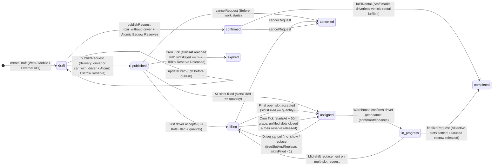
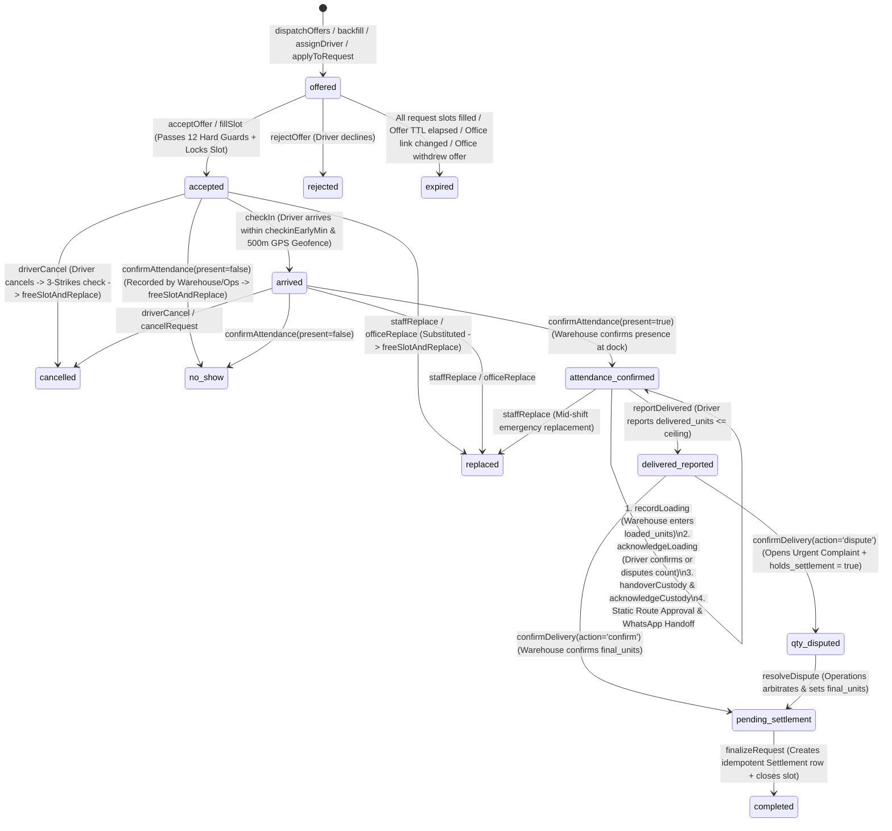
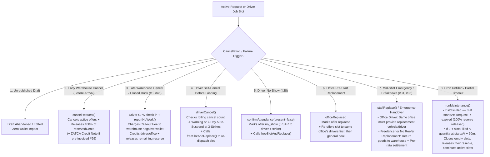

# JR Logistics Platform Master Specification: Onboarding Fields, State Machines, and End-to-End Operational Flows

> **Document Status:** Final Draft for Review & Approval (Incorporating 100% of the platform codebase in [`web/src/server/`](file:///Users/dogorshom/Desktop/Thawani/jr-logisitics/jr-logistics/web/src/server), all 78 operational scenarios, and all custom operational decisions approved by Logistics Operations Management).
> **Scope of Coverage:**
> 1. **Section 1:** Fields Needed for Adding & Verifying a Warehouse (`Business Onboarding, Negative Wallet & Contractual SLA Fields`)
> 2. **Section 2:** Fields Needed for Dealing with a Courier's Office (`Office Onboarding, Commercial Agreements & Affiliated Fleet Fields`)
> 3. **Section 3:** The Complete Multi-Layered Order Lifecycle (`Parent Request × Child Offer/Slot × Custody × Settlement`, 3 Service Types, 9 Sequential Phases, 5 Completed Variants, 8 Cancelled/Replacement Variants, and 8 Returned/RTO Variants)
> 4. **Section 4:** Complete Catalog of All 32 End-to-End Platform Workflows Across 7 System Modules
> 5. **Section 5:** Database Schema Delta Summary

---

## Executive Summary of Custom Operational Decisions Integrated

All custom operational overrides recorded during the 78-scenario review have been embedded directly into the field definitions and workflow rules below:

| Scenario # | Approved Operational Decision | Impact on Platform Fields & Workflows |
| :--- | :--- | :--- |
| **#1** | Repeated warehouse shipment unreadiness (> 2 times/week) lowers loading bay priority and triggers an occupancy reservation fee | Added `unreadiness_strikes_weekly` counter and `occupancy_reservation_fee_cents` to warehouse contract terms |
| **#2** | When extra packages exist at the loading bay (e.g., 75 instead of 50), the driver has the **choice to accept or reject** based on vehicle capacity; if accepted, **both the warehouse and the driver are billed/paid for all 75 packages** | Updated loading & settlement logic to allow `final_units > expected_units` upon driver acceptance and reserve the additional delta from the warehouse's negative wallet |
| **#6** | Loading bay delays (> 60 minutes) extend the driver's SLA and notify the warehouse that repeated delays incur a financial penalty | Added `dock_delay_strikes` and cumulative `dock_delay_penalty_cents` |
| **#9** | **Weight and volume are NOT entered per shipment** on orders; package size standards are **agreed upfront in each warehouse's contract** | Removed per-order weight/volume inputs and added `agreed_package_specs` (`JSONB`) to warehouse contract terms |
| **#19** | Use **Static Routing with approval from the driver/delegate** rather than forced automatic dynamic re-routing | Added `static_route_approved_at` step before route execution |
| **#21** | Mid-route customer address change to another zone: **Return the shipment to the warehouse** (do not divert mid-route for an extra fee) | Updated mid-route diversion handling to transition the package directly to `RTO / returned_to_warehouse` |
| **#22 & #38** | Complex disputes and damaged appliance/white-glove rejections are **resolved through the platform's dispute system** based on inputs from both parties | Linked directly to `complaints` with `holds_settlement = true` until operations arbitration |
| **#23 & #24** | **Disable Cash on Delivery (`COD`) and `POS` network terminals**; customer payments occur online with the merchant | Disabled cash collection and POS custody workflows by default |
| **#26** | Any custody discrepancy or failure to return goods: **Immediate suspension of the driver after the first offense** pending platform review | Enforced immediate `status = 'suspended'` on first custody violation |
| **#29** | Automated 7-day suspension after 3 strikes (`3-Strikes`), **with manual account reactivation capability by platform admins** | Added manual admin override (`POST /admin/drivers/:id/clear-suspension`) |
| **#31** | Mid-shift driver medical/breakdown emergency: If the driver belongs to a **courier office**, the **same office must provide a replacement**; if the driver is a **freelancer**, remaining shipments are **returned to the warehouse or resolved via the platform** | Branched emergency replacement workflow based on `driver.office_id IS NOT NULL` vs `NULL` |
| **#35** | Reefer cooling unit breakdown: Search for a replacement vehicle; if none is available within the specified window, **return the goods to the warehouse** | Removed mobile mechanic dispatch; enforced replacement SLA window or immediate return to origin (`RTO`) |
| **#42** | Zone misclassification by warehouse: **Return out-of-zone shipments to the warehouse and charge a financial penalty to the warehouse** | Added `zone_mismatch_penalty_cents` and mandatory `RTO` for out-of-polygon shipments |
| **#47** | **Remove/Cancel the "Select Preferred Office" feature** when a warehouse creates a request | Disabled `preferred_office_id` selection; all requests route through the fair general matching engine |
| **#48** | Multi-vehicle fleet requests (e.g., 5 Dynas): Add a **checkbox option** when creating the opportunity to choose between **Accept All Slots Together (`all_or_nothing` bundle)** OR **Allow Partial Acceptance (`allow_partial` individual slots)** | Added `slot_acceptance_mode: 'all_or_nothing' \| 'allow_partial'` to `requests` |
| **#49, #52, #53, #56** | **Excluded out-of-scope features:** No live IoT temperature sensor integration (#49), platform is not responsible for emergency mobile refueling (#52), no special ice-cream sub-classification (#53), and no PPE app verification workflow (#56) | Kept system lean by excluding all fields and screens for these four items |
| **#54** | Missing `Gate Pass` at industrial/port security gates: **The recipient must receive the shipment at the gate; if they refuse, the shipment is returned to the warehouse** | Standardized restricted-access procedure: gate handover or immediate `RTO` |

---

## Section 1: Fields Needed for Adding & Verifying a Warehouse (`Warehouse / Business Onboarding Fields`)

A warehouse (`role = 'business'`) is the primary service requester. Its data spans [`users`](file:///Users/dogorshom/Desktop/Thawani/jr-logisitics/jr-logistics/web/src/db/schema.ts#L22-L48), [`businessProfiles`](file:///Users/dogorshom/Desktop/Thawani/jr-logisitics/jr-logistics/web/src/db/schema.ts#L50-L71), [`walletAccounts`](file:///Users/dogorshom/Desktop/Thawani/jr-logisitics/jr-logistics/web/src/db/schema.ts#L395-L406), and [`documents`](file:///Users/dogorshom/Desktop/Thawani/jr-logisitics/jr-logistics/web/src/db/schema.ts#L141-L157).

### 1.1 Account & Identity Fields (`users`)
| Field Name | Description | Type & Constraints | Required? | Validation & Business Rules |
| :--- | :--- | :--- | :---: | :--- |
| `id` | Unique Warehouse User ID | `UUID (PK)` | Auto | Generated automatically upon registration |
| `role` | Account Role | `'business'` | Fixed | Grants access to the Warehouse Portal & Business APIs |
| `name` | Authorized Representative Name | `Text (2–100 chars)` | Yes | Also stored as `business_profiles.responsible_person` |
| `phone` | Official Mobile Number | `Text (Unique, E.164)` | Yes | Normalized to `+9665XXXXXXXX` and verified via 6-digit SMS `OTP` before account creation |
| `email` | Official Corporate Email | `Text (Unique, Lowercase)` | Yes | Used for `ZATCA` tax invoices and financial notifications |
| `city` | Primary Operating City | `Text` | Yes | Must match an enabled pickup city in `settings.cities` (`pickup = true`) |
| `language` | Preferred UI & Notification Language | `'ar' \| 'en' \| 'ur'` | Yes | Defaults to `'ar'` |
| `status` | Account Lifecycle Status | `'active' \| 'suspended'` | Auto | Transitioning to `suspended` immediately revokes all active sessions |

### 1.2 Legal, Commercial & National Address Fields (`business_profiles`)
| Field Name | Description | Type & Constraints | Required? | Validation & Business Rules |
| :--- | :--- | :--- | :---: | :--- |
| `company_name` | Official Registered Trade Name (Ar/En) | `Text (2–150 chars)` | Yes | Must match Commercial Registration; printed on `ZATCA` tax invoices |
| `cr_number` | Commercial Registration / Unified Number | `Text (10 digits)` | Yes | Starts with `1010` or `700`; verified by `hr_verification` staff |
| `tax_number` | VAT Registration Number (`TRN`) | `Text (15 digits)` | Yes | Starts and ends with `3`; mandatory for `ZATCA Phase 2` e-invoicing |
| `industry` | Business Sector / Vertical | `Text (max 80 chars)` | Yes | Food & Beverage, Pharmacy, Electronics, Retail, Wholesale (`B2B`), Auto Parts, etc. |
| `address` | Full Street & District Address | `Text (max 250 chars)` | Yes | Building No, Street, District, Postal Code, Additional Number |
| `national_address_short` | Saudi National Address Short Code *(New)* | `Text (8 chars)` | Yes | 4 letters + 4 digits (e.g., `RRRD2929`) |
| `warehouse_lat` & `warehouse_lng` | Loading Bay GPS Coordinates *(New)* | `Double Precision` | Yes | Reference point used to enforce the `500m Geofence` check-in rule |
| `geofence_radius_meters` | Allowed Check-in Geofence Radius *(New)* | `Integer` | Yes | Defaults to `500` meters |
| `responsible_person` | Loading Bay / Operations Supervisor Name | `Text` | Yes | Primary contact for daily dispatch operations |
| `ops_contact_phone` | Loading Bay Supervisor Mobile *(New)* | `Text (E.164)` | Yes | Displayed to assigned drivers upon offer acceptance |
| `verification_status` | KYC Verification Status | `'pending' \| 'verified' \| 'rejected' \| 'info_requested' \| 'suspended'` | Auto | Cannot publish requests (`publishRequest`) if `requireBusinessVerification = true` and status is not `verified` |
| `verification_note` | Reviewer Feedback Note | `Text` | Cond. | Mandatory when reviewer action is `reject`, `request_info`, or `suspend` |
| `rating_sum` & `rating_count` | Cumulative Driver Rating Score & Count | `Integer` | Auto | Updated atomically when drivers rate the warehouse (`1–5 stars`) after job completion |

### 1.3 Required Legal Documents (`documents` — `owner_kind = 'business'`)
* `business_cr` (**Mandatory**): Valid Commercial Registration certificate (`PDF / JPG / PNG / WEBP`, max `8 MB`, validated via binary magic-byte header inspection).
* `tax_certificate` (**Mandatory for Postpaid/VAT**): `ZATCA` Value Added Tax registration certificate.
* `national_address_cert` (**Recommended**): Official Saudi Post (`SPL`) National Address certificate.

### 1.4 Negative Wallet & Credit Limit Configuration (`wallet_accounts` + `business_profiles`)
| Field Name | Description | Type & Constraints | Financial & Credit Rule |
| :--- | :--- | :--- | :--- |
| `billing_model` | Financial Billing Model *(New)* | `'prepaid' \| 'postpaid_credit'` | Prepaid top-up balance or Postpaid negative wallet with credit ceiling |
| `credit_limit_cents` | Approved Negative Balance Ceiling *(New)* | `Integer (>= 0)` | e.g., `5000000` halalas (`50,000 SAR`). Allows net balance to drop down to `-credit_limit_cents` |
| `available_cents` | Current Available Balance | `Integer` | Can go negative on postpaid accounts; invariant: `available_cents - reserved_cents >= -credit_limit_cents` |
| `reserved_cents` | Escrowed / Reserved Funds for Active Jobs | `Integer (>= 0)` | Reserved atomically on `publishRequest` and released immediately for unused units upon loading/completion/cancellation |
| `billing_cycle` | Invoicing & Repayment Cycle *(New)* | `'weekly' \| 'net_15' \| 'net_30'` | Settlement repayment schedule for negative balances |
| `grace_period_days` | Overdue Grace Period Before Lockout *(New)* | `Integer (Default: 5)` | Days after invoice due date before triggering `Automated Credit Lockout` (Scenario #68) |

### 1.5 Contractual SLA & Penalty Configuration (`Warehouse Contract Terms`)
> **Enforcing Custom Decisions #1, #6, #9, and #42:**
* `agreed_package_specs` (`JSONB` — **Decision #9**): Pre-agreed package size tiers (Small/Medium/Large) and maximum weight per parcel defined in the warehouse contract (eliminating per-shipment weight/volume entry during order creation).
* `approved_zones` (`Text[]` — **Decision #42**): Approved geographic delivery zones mapped to JR's zone polygons.
* `zone_mismatch_penalty_cents` (`Integer` — **Decision #42**): Penalty automatically charged to the warehouse when an address falls outside the declared zone (accompanied by mandatory return of the shipment to the warehouse).
* `loading_grace_period_mins` (`Integer` — **Decision #6**): Free waiting/loading window at the dock after driver check-in (default `60 minutes`).
* `dock_delay_strikes` & `dock_delay_penalty_cents` (`Integer` — **Decision #6**): Counter for repeated loading bay delays exceeding 60 minutes and the financial penalty charged upon repetition (while extending the driver's delivery SLA).
* `unreadiness_strikes_weekly` & `occupancy_reservation_fee_cents` (`Integer` — **Decision #1**): Weekly counter for shipment shortfall/unreadiness at the dock; exceeding `2 strikes/week` lowers dock matching priority and charges an occupancy reservation fee.
* `callout_cancel_fee_cents` (`Integer` — **Scenarios #3 & #46**): Driver show-up compensation fee (e.g., `5,000` halalas / `50 SAR`) charged if the warehouse cancels after driver arrival or if the warehouse is closed.
* `webhook_url` & `webhook_secret` (`Text`): HTTPS endpoint and `HMAC-SHA256` signing secret for real-time ERP/WMS event delivery (protected against `SSRF` and `DNS Rebinding`).

---

## Section 2: Fields Needed for Dealing with a Courier's Office (`Courier Office & Fleet Fields`)

A courier office (`role = 'office'`) is a fleet partner that manages affiliated drivers and vehicles and receives consolidated financial settlements on their behalf. Its data spans [`officeProfiles`](file:///Users/dogorshom/Desktop/Thawani/jr-logisitics/jr-logistics/web/src/db/schema.ts#L73-L92), [`officeAgreements`](file:///Users/dogorshom/Desktop/Thawani/jr-logisitics/jr-logistics/web/src/db/schema.ts#L129-L139), [`officeInvites`](file:///Users/dogorshom/Desktop/Thawani/jr-logisitics/jr-logistics/web/src/db/schema.ts#L117-L127), and [`driverProfiles`](file:///Users/dogorshom/Desktop/Thawani/jr-logisitics/jr-logistics/web/src/db/schema.ts#L94-L115).

### 2.1 Office Legal & Financial Profile (`office_profiles`)
| Field Name | Description | Type & Constraints | Required? | Validation & Business Rules |
| :--- | :--- | :--- | :---: | :--- |
| `user_id` | Unique Office User ID | `UUID (PK, FK -> users.id)` | Auto | Linked to a user account with `role = 'office'` |
| `office_name` | Registered Courier Office Name | `Text (2–150 chars)` | Yes | Displayed in admin operations, settlements, and driver profiles (not selectable as a preferred office by warehouses per **Decision #47**) |
| `cr_number` | Commercial Registration Number | `Text (10 digits)` | Yes | Mandatory for legal verification |
| `tga_license_number` | Transport General Authority (`TGA / Wasl`) License *(New)* | `Text` | Yes | Verified via `office_license` document |
| `tax_number` | Office VAT Registration Number | `Text (15 digits)` | Yes | Required for VAT settlement accounting |
| `city` | Primary Operating City | `Text` | Yes | Must be an enabled city in platform settings |
| `address` | Official Head Office Address | `Text` | Yes | Used for legal notices and billing |
| `responsible_person` | Fleet / Operations Manager Name | `Text` | Yes | Point of contact for emergency vehicle/driver replacements (**Decision #31**) |
| `bank_name` | Approved Bank Name | `Text` | Yes | Used for payout batches and withdrawal transfers |
| `iban` | Saudi IBAN (`SA + 22 digits`) | `Text (24 chars)` | Yes | Validated via `/^SA\d{22}$/`; mandatory before requesting withdrawals |
| `verification_status` | Office Verification Status | `'pending' \| 'verified' \| 'rejected' \| 'info_requested' \| 'suspended'` | Auto | **Readiness Gate (`readyOfficeIds`):** An office and its linked drivers can only receive jobs when `users.status = 'active'`, `verification_status = 'verified'`, and an unexpired `office_agreements` row has `status = 'accepted'` |

### 2.2 Required Office Documents (`documents` — `owner_kind = 'office'`)
* `office_cr` (**Mandatory**): Valid Commercial Registration certificate.
* `office_license` (**Mandatory**): Transport General Authority (`TGA`) operating license.
* `iban_certificate` (**Recommended**): Stamped bank IBAN certificate matching the legal entity name.

### 2.3 Office Commercial Agreement Fields (`office_agreements`)
| Field Name | Description | Type & Constraints | Operational & Legal Rule |
| :--- | :--- | :--- | :--- |
| `version` | Agreement Version Number | `Integer (Auto-increment per office)` | Creating a new agreement automatically marks any prior `pending_acceptance` version as `superseded` |
| `status` | Agreement Lifecycle State | `'pending_acceptance' \| 'accepted' \| 'superseded' \| 'expired'` | Office must explicitly accept via `POST /office/agreements/:id/accept` to unlock fleet dispatch |
| `terms` | Full Commercial & SLA Terms Text | `Text (up to 10,000 chars)` | Includes mandatory replacement SLA and 100% office wallet settlement routing |
| `replacement_sla_mins` | Emergency Replacement SLA Window *(New)* | `Integer (Default: 45)` | **Decisions #31 & #35:** Maximum minutes allowed for the office to dispatch a replacement driver/vehicle from the same office upon breakdown or medical emergency |
| `effective_at` & `expires_at` | Effective Date & Expiration Timestamp | `Timestamp` | Once `expires_at <= now()`, `readyOfficeIds` automatically blocks the office's fleet until a new agreement is accepted |
| `created_by` & `accepted_at` | Staff Creator ID & Acceptance Timestamp | `UUID / Timestamp` | Recorded in immutable `audit_logs` |

### 2.4 Affiliated Driver, Vehicle & Office Link Fields (`driver_profiles` & `office_invites`)
| Field Name | Description | Type & Constraints | Operational & Financial Rule |
| :--- | :--- | :--- | :--- |
| `office_id` | Linked Courier Office ID | `UUID (Nullable)` | `NULL` = Independent Freelancer (`direct`); `UUID` = Office-Affiliated Driver (`linked`). 100% of settlements for linked drivers route to `office_id` |
| `office_link_status` | Affiliation Status | `'direct' \| 'linked'` | Whenever a driver links to or unlinks from an office, `dropStaleOffers` immediately expires all unaccepted `offered` jobs so no job is ever settled to the wrong party |
| `national_id` | National ID / Iqama Number | `Text (10 digits)` | Masked in admin views unless staff member holds `drivers.sensitive` permission |
| `vehicle_type` | Vehicle Category | `'sedan' \| 'dokker' \| 'hiace' \| 'van' \| 'dyna'` | Enforced as a hard eligibility guard during matching |
| `vehicle_temperature` | Thermal Capability (`van` / `dyna` only) | `'dry' \| 'cold' \| null` | Mandatory when `vehicle_type` is `van` or `dyna` |
| `vehicle_plate` | License Plate Number | `Text` | Used for warehouse gate security verification |
| `max_package_capacity` | Maximum Parcel Capacity *(New)* | `Integer` | Determines whether the driver can accept extra packages at the loading bay (**Decision #2**) |
| `services` | Qualified Service Types | `Text[]` | Subset of `['delivery_driver', 'car_with_driver']` |
| `availability` | Real-Time Shift Availability | `'available' \| 'unavailable'` | Toggling to `available` triggers `backfillOffersForDriver` to immediately push qualifying open jobs |
| `verification_status` | Derived Document Verification State | `'pending' \| 'verified' \| 'rejected' \| 'expired'` | **Automatically computed (`recomputeDriverVerification`):** Requires approved, unexpired `national_id`, `driving_license`, and `vehicle_registration`. Automatically flips to `expired` the day any document lapses (Scenario #77) |
| `suspended_until` & `strikes_reset_at` | Auto-Suspension End & Strike Reset Timestamps | `Timestamp (Nullable)` | Set for 7 days upon reaching 3 cancellation/no-show strikes; can be manually cleared at any time by admins via `clearSuspension` (**Decision #29**) |

---

## Section 3: The Complete Multi-Layered Order Lifecycle (`Order Flows: Completed, Cancelled, Returned`)

> **Why the JR Logistics Order Flow is Multi-Layered:**
> A single `Request` is not a flat record—it is a **parent operational and escrow container** that spawns `1 to 500` independent **Job Slots (`Offers`)**. Each slot has its own driver, GPS check-in, loading bay count, physical custody manifest (`Custody Items`), WhatsApp communication log, dispute gate, and financial `Settlement`, while the parent `Request` coordinates slot concurrency, partial vs. full staffing, and escrow reserve releases.

---

### 3.1 The 4 Interlocking State Machines

#### A) Parent Request State Machine (`9 States`)

#### B) Child Offer / Job Slot State Machine (`13 States`)

---

### 3.2 Behavioral Differences Across the 3 Service Types

Defined in [`catalog.ts`](file:///Users/dogorshom/Desktop/Thawani/jr-logisitics/jr-logistics/web/src/server/catalog.ts#L14-L18), the platform supports three distinct service models:

| Dimension | 1. Delivery Driver (`delivery_driver`) | 2. Vehicle with Driver (`car_with_driver`) | 3. Vehicle without Driver (`car_without_driver`) |
| :--- | :--- | :--- | :--- |
| **Pricing Unit (`unit`)** | Per Shipment (`shipment`) | Per Vehicle-Day (`vehicle_day`) | Per Vehicle-Day (`vehicle_day`) |
| **Expected Units per Slot (`expectedUnits`)** | `shipmentsPerDriver` (parcels per driver) | `durationDays` (rental days: `1–90`) | `durationDays` (rental days: `1–90`) |
| **Total Escrow Reserve (`totalCents`)** | `priceCents × quantity × shipmentsPerDriver` | `priceCents × quantity × durationDays` | `priceCents × quantity × durationDays` |
| **Status After Publish (`publishRequest`)** | `published` ➔ dispatches offers to drivers | `published` ➔ dispatches offers to drivers | `confirmed` immediately (`driverless = true`, no driver offers) |
| **Loading Bay Count (`recordLoading`)** | **Mandatory** (with driver `acknowledgeLoading`) | Not applicable (`hasShipments = false`) | Not applicable (`driverless = true`) |
| **Completion Mechanism** | Driver reports delivered units ➔ Warehouse confirms ➔ Per-offer `Settlement` | Driver reports completed days ➔ Warehouse confirms ➔ Per-offer `Settlement` | Operations staff executes `POST /admin/requests/:id/fulfil-rental` |

---

### 3.3 The 9 Sequential Phases of an Order Lifecycle

#### Phase 1: Pricing Resolution & Live Estimate (`POST /requests/estimate`)
* Executes [`resolveRule()`](file:///Users/dogorshom/Desktop/Thawani/jr-logisitics/jr-logistics/web/src/server/pricing.ts#L24-L41) using a strict **3-tier Specificity Hierarchy**:
  1. **Business-Specific Override Wins:** A rule with `business_id = user.id` always beats a global rule (`business_id IS NULL`).
  2. **Dimension Specificity Wins:** Rules matching more explicit dimensions (`vehicle_type + temperature + pickup_city + delivery_city`) beat wildcard (`NULL`) dimensions.
  3. **Recency Wins:** Highest `version DESC`, then newest `effective_at DESC`.
* **Margin Confidentiality:** Returns `publicQuote` (customer unit price and total only); `providerCostCents` and `marginCents` are stripped from all business-facing responses.

#### Phase 2: Draft Creation, Validation Gates & Atomic Escrow Reserve (`publishRequest`)
* Executed via `POST /requests` (with `publish: true`) or `POST /requests/:id/publish`:
  1. Acquires a row-level lock (`SELECT ... FOR UPDATE`) on `requests`.
  2. Verifies `termsAccepted = true` and logs legal consent in `terms_consents`.
  3. Verifies warehouse `verification_status === 'verified'`.
  4. Validates future `startsAt` and non-empty pickup/delivery addresses.
  5. **Enforces Decision #47:** Ignores/disables `preferredOfficeId` so all jobs go to the general matching pool.
  6. **Enforces Decision #48:** Persists `slot_acceptance_mode` (`'all_or_nothing'` bundle vs `'allow_partial'` slots).
  7. **Atomic Escrow Reserve:** Posts a `reserve` ledger entry deducting `quote.totalCents` from `available_cents` (allowed down to `-credit_limit_cents`) and adding it to `reserved_cents` with idempotency key `reserve:{requestId}`, freezing `pricing_snapshot` on the request.

#### Phase 3: Smart Matching Engine, 12 Hard Guards & Offer Dispatch (`dispatchOffers`)
* [`evaluateCandidates()`](file:///Users/dogorshom/Desktop/Thawani/jr-logisitics/jr-logistics/web/src/server/matching.ts#L51-L93) evaluates all active drivers against **12 Hard Eligibility Guards** (a candidate failing any guard gets `score = 0` and cannot be assigned):
  1. `not_verified` (missing or expired driver/vehicle documents)
  2. `unavailable` (driver shift toggle is off)
  3. `suspended` (`suspended_until > now()`)
  4. `service_mismatch` (request service not in driver's `services` array)
  5. `vehicle_mismatch` (driver's `vehicle_type` != request's `vehicle_type`)
  6. `temp_mismatch` (driver's `vehicle_temperature` != request's `temperature` for `van`/`dyna`)
  7. `city_mismatch` (driver's city != `pickup_city`)
  8. `office_ineligible` (driver belongs to an office that is unverified, suspended, or lacks an accepted unexpired agreement)
  9. `already_offered` (driver already has an active/prior offer on this request)
  10. `time_overlap` (driver has an active job in `OFFER_BUSY` overlapping `startsAt .. startsAt + durationDays`, or `overlapPolicy === 'single_active'`)
* **Explainable Scoring Formula (Max 80 Points):**
  * Base Score: `+50`
  * Rating Bonus: `+0 to +20` (`Math.min(Math.round(avgRating * 4), 20)`)
  * Experience Bonus: `+0 to +10` (`Math.min(jobsCompleted, 10)`)
  * Recent Cancellation Penalty: `-0 to -15` (`-3 points` per driver cancellation within `cancelWindowDays` after `strikesResetAt`).
* **4 Offer Creation Channels:**
  1. **System Auto-Dispatch (`source = 'system'`):** Dispatches offers to the top `min(openSlots × 5, 30)` candidates on publish, or via `backfillOffersForDriver` when an offline driver toggles `available = true`.
  2. **Driver Direct Application (`source = 'apply'`):** Driver applies from the Open Opportunities feed (`POST /driver/requests/:id/apply`).
  3. **Courier Office Assignment (`source = 'office'`):** Office manager assigns an eligible linked driver (`POST /office/opportunities/:id/assign`).
  4. **Operations Manual Assignment (`source = 'manual'`):** Backoffice staff assigns a specific driver with an audited reason (`POST /admin/requests/:id/assign`).

#### Phase 4: Offer Acceptance & Multi-Slot Concurrency Control (`fillSlot`)
* Deadlock-free locking order: **always locks `requests` first, then `offers` second**.
* Re-verifies all 12 eligibility guards inside the transaction, increments `slots_filled`, updates the offer to `accepted`, and transitions the parent request to:
  * `filling` (when `0 < slots_filled < quantity`), or
  * `assigned` (when `slots_filled === quantity`), automatically expiring all remaining `offered` rows on that request.

#### Phase 5: Geofence Arrival Check-in, Attendance Confirmation & "Not Put To Work"
* **Driver Check-in (`POST /offers/:id/checkin`):** Allowed starting `checkinEarlyMin` before `startsAt` within the warehouse's `500m GPS Geofence`. Transitions offer to `arrived` and records `arrived_lat`, `arrived_lng`, `arrived_at`.
* **Warehouse Attendance Decision (`POST /offers/:id/attendance`):**
  * `present = true`: Transitions offer to `attendance_confirmed` and parent request (if fully staffed) to `in_progress`.
  * `present = false` (with mandatory `reason`): Transitions offer to `no_show` and immediately invokes `freeSlotAndReplace()` to decrement `slots_filled` and dispatch replacement offers.
* **Driver "Not Put To Work" Escalation (`POST /offers/:id/no-work`):** If a driver is `arrived` or `attendance_confirmed` but the warehouse ignores them or has no shipments, the driver triggers `reportNoWork`, opening an urgent `not_put_to_work` operations ticket (Scenarios #3 & #57).

#### Phase 6: Loading Bay Count, Over/Under-Capacity Handling & Physical Custody
* **Warehouse Records Loaded Units (`POST /offers/:id/loading`):** Sets `loaded_units` and `loaded_at`, resetting `loaded_ack_by_driver = null`.
* **4 Loading Bay Capacity Outcomes:**
  1. **Exact Match (`loaded_units == expected_units`):** Driver acknowledges (`POST /offers/:id/loading-ack` with `ok = true`).
  2. **Under-Loading / Shortfall (`loaded_units < expected_units` — Scenario #1):** Driver acknowledges the lower count (`ok = true`). If the warehouse repeats this > 2 times/week, its dock priority drops and an occupancy reservation fee is charged.
  3. **Over-Loading / Extra Packages (`loaded_units > expected_units` — Approved Decision #2):**
     * The driver is prompted to **Accept** (if within vehicle `max_package_capacity`) or **Reject** the extra units.
     * If accepted (`ok = true`, `extra_units_accepted = true`), the system increases the slot's billable ceiling to `loaded_units`, reserves the additional funds from the warehouse's negative wallet, and **bills the warehouse and pays the driver for the entire loaded quantity (e.g., all 75 units)**.
  4. **Loading Count Dispute (`ok = false`):** If the driver disagrees with the count entered by the warehouse, `acknowledgeLoading(false)` sets `loaded_ack_by_driver = false`, blocks delivery reporting, and automatically opens a `shipment_count_differs` support ticket.
* **Physical Custody Handover (`POST /offers/:id/custody` ➔ `POST /custody/:id/acknowledge`):**
  * Warehouse logs physical equipment handed to the driver (thermal bags, smart padlocks, etc.—excluding COD cash/POS terminals per **Decisions #23 & #24**), and the driver acknowledges receipt (`status = 'acknowledged'`).

#### Phase 7: Static Route Approval, WhatsApp Handoff & Contact Exceptions
* **Static Route Approval (`POST /driver/route/optimize` — Decision #19):** Computes a static stop sequence (`Nearest-Neighbor + 2-Opt` refinement) approved by the driver prior to departure (no forced dynamic mid-drive re-routing).
* **Audited WhatsApp Handoff (`GET /driver/jobs/:id/whatsapp`):** Generates pre-filled `wa.me` deep links in Arabic, English, or Urdu (`contact`, `arriving`, `issue`) and logs `whatsapp_handoff_opened` in `job_events` as immutable proof of contact initiation.
* **Recipient Contact Exception (`POST /driver/jobs/:id/contact-exception`):** After waiting 10 minutes on-site, the driver logs `no_answer | wrong_number | refused | other`, recording a `contact_exception` event and opening an `attendance_issue` ticket.

#### Phase 8: Delivery Reporting, Dispute Gate & Operations Arbitration
* **Driver Reports Delivered Quantity (`POST /offers/:id/delivered`):** Requires `loaded_ack_by_driver === true` (for shipment jobs) and validates `delivered_units <= ceiling`. Transitions offer to `delivered_reported`.
* **Warehouse Delivery Decision (`POST /offers/:id/delivery-decision`):**
  * **Confirm (`action = 'confirm'`):** Sets `final_units`, transitions offer to `pending_settlement`, and triggers `completeIfReady()`.
  * **Dispute (`action = 'dispute'` — Decisions #22 & #38):** Transitions offer to `qty_disputed` and automatically files an urgent formal complaint (`complaints` with `holds_settlement = true`), freezing payout for that job until operations resolves it via `POST /admin/offers/:id/resolve-dispute`.

#### Phase 9: Request Finalization, Unspent Escrow Release & Mutual Rating
* When all active offers on a request reach `pending_settlement` (via `completeIfReady` or `POST /requests/:id/complete` for partially staffed requests):
  1. Creates an idempotent `settlements` record per offer (`UNIQUE(offer_id)`).
  2. Transitions each offer to `completed` and expires any remaining `offered` rows.
  3. Immediately releases unspent escrow (`complete-release:{requestId}`) back to the warehouse's `available_cents`.
  4. Transitions parent request to `completed` and unlocks two-way `1–5 star` ratings (`POST /offers/:id/rate`).

---

### 3.4 The 5 Completed Order Flow Variants

| Completed Variant | Operational Scenario | State Progression (`Request` / `Offer`) | Financial & Ledger Execution |
| :--- | :--- | :--- | :--- |
| **1. Standard 100% Parcel Delivery** | Warehouse books 50 parcels ➔ Driver loads 50 and delivers all 50 | `Request`: `draft -> published -> assigned -> in_progress -> completed` `Offer`: `offered -> accepted -> arrived -> attendance_confirmed -> delivered_reported -> pending_settlement -> completed` | • `release_reserve`: `+50 × unitPrice` • Warehouse `charge`: `-50 × unitPrice` • Office/Driver `payout`: `+50 × providerCost` • JR `platform_fee`: `+50 × margin` • Generates `ZATCA` invoice for 50 units |
| **2. Under-Capacity / Partial Loading Delivery (Scenario #1)** | Warehouse books 50 parcels, hands over 30 at the dock, and driver delivers all 30 | Same state progression with `expected_units = 50`, `loaded_units = 30`, `final_units = 30` | • Warehouse billed for 30 units (`30 × unitPrice`) • Unused 20 units (`refundCents = 20 × unitPrice`) released back to warehouse credit limit • If warehouse repeats shortfall > 2x/week: dock priority lowered + `occupancy_reservation_fee` charged |
| **3. Over-Capacity / Extra Units Accepted Delivery (Decision #2)** | Warehouse books 50 parcels, presents 75 at the dock ➔ Driver accepts extra 25 within vehicle capacity and delivers all 75 | On `recordLoading(75)` + driver `acknowledgeLoading(true)`: slot ceiling updates to `75` with additional escrow reserve for +25 units | • **Per Decision #2:** Warehouse is charged for **all 75 units** (`75 × unitPrice`) • Driver/Office is paid for **all 75 units** (`75 × providerCost`) • `ZATCA` invoice issued for all 75 units |
| **4. Daily Chauffeur / Vehicle with Driver (`car_with_driver`)** | Warehouse books 1 refrigerated Dyna with driver for 5 days (`durationDays = 5`) | Skips parcel loading count (`hasShipments = false`); tracks daily attendance and confirms `final_units = 5` days | • Billed per `vehicle_day` • `customerCents = 5 × dailyPrice` • `providerCents = 5 × dailyProviderCost` |
| **5. Driverless Fleet Rental (`car_without_driver`)** | Warehouse rents 3 dry vans without drivers for 10 days | `Request`: `draft -> confirmed -> completed` (via staff `POST /admin/requests/:id/fulfil-rental`, zero driver offers) | • Deducts full `reservedCents` from warehouse via `charge` and credits `platform_fee` on platform account |

---

### 3.5 The 8 Cancelled & Replacement Order Flow Variants

---

### 3.6 The 8 Returned Order (`RTO`) & Custody Flows

Whenever a parcel cannot be delivered, the driver logs a timestamped, GPS-tagged exception in `job_events`, and the parcel enters the driver's return custody manifest (`RTO`) to be handed back to the warehouse loading bay at the end of the shift:

| RTO Scenario | Field Trigger | Mandatory Driver & System Action | Financial, Credit & Disciplinary Rule |
| :--- | :--- | :--- | :--- |
| **1. Customer Unreachable / No Answer (#14)** | Driver arrives at delivery pin; customer does not answer phone/intercom | 1. Wait 10 minutes on-site (`GPS Timer`) 2. Open WhatsApp handoff `GET /whatsapp?kind=issue` 3. Submit `POST /contact-exception` (`no_answer`) 4. Return parcel to warehouse dock | Driver/Office earns full delivery fee for verified attempt once warehouse scans returned parcel |
| **2. Customer Refusal at Door (#15)** | Recipient refuses delivery at doorstep | Submit `POST /contact-exception` (`refused`) + return parcel to warehouse dock | Driver/Office earns delivery fee; driver is not penalized for customer refusal |
| **3. Mid-Route Customer Address Change Request (Decision #21)** | Customer asks driver to deliver to a different neighborhood/zone mid-route | **Approved Decision #21:** Mid-route diversion is strictly prohibited; driver logs exception and **returns the shipment directly to the warehouse (`RTO`)** | Returned to warehouse to be re-dispatched in a new order under the correct zone |
| **4. Warehouse Zone Misclassification / Out-of-Polygon (Decision #42)** | Actual delivery address falls outside the warehouse's declared JR zone | **Approved Decision #42:** Driver flags out-of-zone address; **shipment is returned to the warehouse (`RTO`)** | **Warehouse is charged `zone_mismatch_penalty_cents`** on its negative wallet to compensate driver and platform |
| **5. Missing Security/Port `Gate Pass` (Decision #54)** | Security gate denies entry due to missing warehouse gate pass | **Approved Decision #54:** Driver contacts customer to pick up at the gate; if customer refuses, **shipment is returned immediately to the warehouse (`RTO`)** | Warehouse bears trip cost due to missing gate pass / customer refusal at gate |
| **6. Damaged Goods / Appliance Rejection (Decision #22)** | Customer rejects parcel/appliance citing visible damage | Driver photographs item + returns to warehouse + files **Platform Dispute (`fileComplaint` with `holdsSettlement = true`)** | Settlement for this job is held until operations arbitrates using pre-load vs post-return photos |
| **7. Mid-Shift Vehicle / Reefer Breakdown (Decisions #31 & #35)** | Mechanical failure, cooling failure, or medical emergency mid-route | • **Office-Linked Driver:** Same courier office must dispatch a replacement vehicle/driver to take over remaining parcels. • **Freelance Driver (or no reefer replacement within SLA):** Remaining parcels are **returned immediately to the warehouse** | If completed by office replacement: full settlement to office. If returned by freelancer: `Pro-rata` settlement for delivered parcels only; remaining reserve released |
| **8. Unreturned RTO Parcel / Custody Breach (Decision #26)** | Shift ends and warehouse records `POST /custody/:id/return` as `not_returned` or missing RTO parcels | **Approved Decision #26:** 1. Freeze all pending driver/office settlements (`holds_settlement = true`). 2. **Immediately suspend the driver after the first offense (`status = 'suspended'`)** pending platform investigation | Value of unreturned goods is deducted from held earnings; driver remains suspended until admin review |

---

## Section 4: Complete Catalog of All 32 End-to-End Platform Workflows

### Module A: Identity, Authentication, MFA & Role-Based Security (`Flows 1–4`)

1. **Flow 1 — Unified Phone OTP Login & Registration Token Flow:**
   * `POST /auth/otp/send` (rate-limited to 3 per 10 mins per phone and 20 per IP; silently masks staff phone numbers to prevent enumeration) ➔ `POST /auth/otp/verify` (`HMAC-SHA256` hashed 6-digit code, max 5 attempts).
   * Existing active user: issues session token (`7-day` web cookie / `30-day` mobile bearer token).
   * New phone number: returns a 15-minute signed `registrationToken` for `POST /auth/register`.
2. **Flow 2 — Staff Email/Password Login & Brute-Force Lockout Flow:**
   * `POST /auth/staff/login`: Verifies `bcrypt` password hash (using constant-time dummy verification when email is unknown). After 5 consecutive failed attempts, locks the staff account for 15 minutes (`locked_until`), which can be cleared early by an admin via `POST /admin/staff/:id/unlock`.
3. **Flow 3 — Staff Two-Factor Authentication (`TOTP MFA & Recovery Codes`) Flow:**
   * `POST /auth/mfa/setup` ➔ `POST /auth/mfa/enable` (generates 8 one-time recovery codes). When MFA is enabled, password login returns a 5-minute `mfaToken` that only grants a session after `POST /auth/staff/login/mfa`.
4. **Flow 4 — Granular RBAC & Anti-Privilege-Escalation Flow:**
   * `POST /admin/staff` & `PATCH /admin/staff/:id`: Supports 6 role presets (`support`, `operations`, `finance`, `hr_verification`, `account_manager`, `reports`) and 34 granular permissions. Enforces `assertGrantable`: no staff manager can grant a permission they do not hold themselves, and any permission change or suspension immediately revokes all active sessions (`revokeAllSessions`).

---

### Module B: Onboarding, KYC Verification & Document Expiry Guard (`Flows 5–8`)

5. **Flow 5 — Warehouse (`Business`) Onboarding, KYC & Credit Limit Setup Flow:**
   * `POST /auth/register` (`role = 'business'`) ➔ auto-creates wallet (`ensureAccount`) ➔ uploads `business_cr` and `tax_certificate` (`POST /documents`) ➔ reviewed in `GET /admin/verification-queue` via `POST /admin/users/:id/verification` (`verify | reject | request_info | suspend`) ➔ configures negative wallet `credit_limit_cents` and `agreed_package_specs` (**Decision #9**).
6. **Flow 6 — Courier Office Onboarding & TGA Verification Flow:**
   * `POST /auth/register` (`role = 'office'`) with Saudi IBAN normalization (`/SA\d{22}/`) ➔ uploads `office_cr` and `office_license` ➔ staff verification approval.
7. **Flow 7 — Magic-Byte Document Upload & Audited File Access Flow:**
   * `POST /documents`: Validates file size (`<= 8 MB`), future `expiresOn` date, and inspects binary file headers (`Magic Bytes` in [`matchesMime()`](file:///Users/dogorshom/Desktop/Thawani/jr-logisitics/jr-logistics/web/src/server/accounts.ts#L201-L210)) to guarantee authentic `PDF`, `JPEG`, `PNG`, or `WEBP` content. Every non-owner view (`GET /documents/:id/file`) writes a `document.view` entry to `audit_logs`.
8. **Flow 8 — Derived Driver Verification & Automatic Expiry Lockout Flow:**
   * [`recomputeDriverVerification()`](file:///Users/dogorshom/Desktop/Thawani/jr-logisitics/jr-logistics/web/src/server/accounts.ts#L253-L268): Driver verification is never toggled arbitrarily; it is automatically derived from having approved, unexpired `national_id`, `driving_license`, and `vehicle_registration` documents. The moment any required document expires, the driver's status flips to `expired` and they are blocked from receiving or accepting jobs (Scenario #77).

---

### Module C: Courier Office Agreements, Driver Invitations & Fleet Linking (`Flows 9–12`)

9. **Flow 9 — Office Commercial Agreement Versioning & Acceptance Flow:**
   * Admin creates a new agreement version (`POST /admin/offices/:id/agreements`), superseding any pending draft. Office accepts via `POST /office/agreements/:id/accept`, superseding prior accepted versions and unlocking `readyOfficeIds`.
10. **Flow 10 — Office-to-Driver Phone Invitation Flow (`Pre- & Post-Registration`):**
    * Verified office invites a driver by phone (`POST /office/drivers/invite`). Validates phone is not a business/office or already linked to another office. If the driver has not registered yet, the invite stays `pending` by phone number and automatically binds to `driver_id` the moment that phone registers!
11. **Flow 11 — Driver Invite Acceptance & Stale Offer Purge Flow:**
    * Driver responds via `POST /driver/invites/:id/respond`. Blocks linking while the driver has an active job (`OFFER_BUSY`), links the driver (`office_id`, `office_link_status = 'linked'`), and executes `dropStaleOffers` to expire all unaccepted `offered` rows so settlements never route to the wrong wallet.
12. **Flow 12 — Driver Unlinking by Office or Admin Flow:**
    * `POST /office/drivers/:id/unlink` or `POST /admin/drivers/:id/unlink-office`: Requires zero active jobs (`OFFER_BUSY`), resets driver to `office_id = null` (`direct`), and purges stale open offers.

---

### Module D: Pricing Engine, Smart Matching & Multi-Slot Dispatch (`Flows 13–17`)

13. **Flow 13 — Versioned Pricing Rule Creation & Automatic Retirement Flow:**
    * `POST /admin/pricing`: Validates `providerCostCents <= priceCents`. If an approved rule with the exact same dimension tuple already exists, it is automatically marked `retired` and the new rule increments `version + 1` so historical `pricing_snapshot` references remain immutable.
14. **Flow 14 — Automated Dispatch & Online Driver Backfill Flow:**
    * Dispatches offers upon request publication (`dispatchOffers`). When a driver toggles availability to `available` (`PUT /driver/availability`), `backfillOffersForDriver` immediately scans up to 50 open requests and creates up to 10 instant offers for that driver.
15. **Flow 15 — Operations Smart Suggest & One-Click Rematch Flow:**
    * `GET /admin/requests/:id/suggest`: Returns top 50 candidates with their exact score breakdown (`factors`) or disqualification reasons (`reasons`).
    * `POST /admin/requests/:id/rematch`: Re-runs `dispatchOffers` for any open slots on a `published` or `filling` request.
16. **Flow 16 — Proactive Driver Application & Office Slot Assignment Flow:**
    * Drivers can self-apply to open requests (`POST /driver/requests/:id/apply`) and offices can assign linked drivers (`POST /office/opportunities/:id/assign`), both serialized on the request lock and gated by all 12 eligibility checks.
17. **Flow 17 — Multi-Vehicle Fleet Allocation (`All-or-Nothing` vs `Allow Partial` — Decision #48):**
    * Enforces the warehouse's checkbox selection (`slot_acceptance_mode`): either requires full bundle staffing (`all_or_nothing`) or permits individual slot filling (`allow_partial`) with automated escrow release for unfilled slots.

---

### Module E: Field Execution, Custody, In-Job Chat, Tickets & Complaints (`Flows 18–22`)

18. **Flow 18 — Privacy-Guarded Live GPS Telemetry & Audited Live Map Flow:**
    * `POST /driver/location`: Only accepts coordinates while the driver is `available` or holding an `OFFER_BUSY` job; going `unavailable` wipes coordinates (`clearDriverLocation`). Every staff view of `GET /admin/ops/map` (showing pings within the last 30 mins) is recorded in `audit_logs` (`location.view`).
19. **Flow 19 — Physical Custody Handover, Driver Acknowledgement & Return Flow:**
    * `POST /offers/:id/custody` (`handed_over`) ➔ `POST /custody/:id/acknowledge` (`acknowledged`) ➔ `POST /custody/:id/return` (`returned | not_returned | damaged`). First unreturned custody offense triggers immediate driver suspension (**Decision #26**).
20. **Flow 20 — Job-Scoped Multi-Party Chat Flow:**
    * `GET / POST /offers/:id/messages`: Real-time message thread shared between the Warehouse, Assigned Driver, Linked Courier Office, and Support Staff. Automatically locks for non-staff once the request is `completed` or `cancelled`.
21. **Flow 21 — Role-Scoped Support Tickets & Urgent Ops Escalation Flow:**
    * `POST /tickets` & `POST /requests/:id/urgent-help`: Automatically elevates `urgent`, `driver_no_show`, `business_not_ready`, and `not_put_to_work` tickets to `priority = 'urgent'`, notifies operations, and supports internal-only staff notes (`internal = true`).
22. **Flow 22 — Formal Complaints Lifecycle & Settlement Hold Gate Flow (Decisions #22 & #38):**
    * `POST /complaints` & `PATCH /admin/complaints/:id`: State machine (`open -> in_progress -> resolved -> closed`). Any open/in-progress complaint with `holds_settlement = true` blocks `approveSettlement` and `payoutTx` (`DISPUTE_BLOCKS`) until resolved with a mandatory `resolution` note.

---

### Module F: Double-Entry Ledger, Negative Wallet, Dual-Control Settlements & ZATCA (`Flows 23–28`)

23. **Flow 23 — Atomic Double-Entry Ledger & Negative Credit Limit Flow:**
    * [`post()`](file:///Users/dogorshom/Desktop/Thawani/jr-logisitics/jr-logistics/web/src/server/wallet.ts#L51-L73): Every balance mutation writes an immutable `ledger_entries` row guarded by `UNIQUE(idempotency_key)`. Supports negative `available_cents` down to `-credit_limit_cents` for postpaid warehouses and instant top-ups via `POST /wallet/topup`.
24. **Flow 24 — Two-Person Rule (`Separation of Duties`) Settlement Approval Flow (Scenario #71):**
    * When `separationOfDuties` is enabled:
      1. Finance Reviewer marks `pending_review -> reviewed` (`POST /admin/finance/settlements/:id/review`).
      2. Finance Approver marks `reviewed -> approved` (`POST /admin/finance/settlements/:id/approve`), strictly enforcing `s.reviewedBy !== actor.id`.
25. **Flow 25 — Pre-Payout Finance Quantity Correction Flow:**
    * [`correctSettlement()`](file:///Users/dogorshom/Desktop/Thawani/jr-logisitics/jr-logistics/web/src/server/settlement.ts#L198-L220): Allows finance to adjust `finalUnits` prior to payout with an audited reason, recomputing customer charge, provider payout, margin, VAT, and refund, and resetting status back to `pending_review` so two-person approval runs again.
26. **Flow 26 — Isolated Batch Payout Execution & Failed Settlement Retry Flow:**
    * `POST /admin/finance/payout-batches` ➔ [`runPayoutBatch()`](file:///Users/dogorshom/Desktop/Thawani/jr-logisitics/jr-logistics/web/src/server/settlement.ts#L132-L159): Processes up to 200 approved settlements, each in its own database transaction (`release_reserve` + `charge` on business wallet, `payout` to office/driver wallet, `platform_fee` to platform wallet). Skips complaint-held items without failing the batch, marks unexpected errors as `failed`, and allows retry via `POST /admin/finance/settlements/:id/retry`.
27. **Flow 27 — Driver & Courier Office Bank Withdrawal Flow (Scenario #70):**
    * `POST /withdrawals`: Validates `amountCents >= minWithdrawalCents` and valid `SA` IBAN, moving funds from `available_cents` to `held_cents` (`withdrawal_hold`).
    * Finance decision (`POST /admin/finance/withdrawals/:id/decision`): `paid` (with bank `paymentRef`) deducts `held_cents` permanently (`withdrawal_paid`); `rejected` (or bounced bank transfer) returns `held_cents` back to `available_cents` (`withdrawal_release`).
28. **Flow 28 — Automated `ZATCA Phase 2` VAT Invoicing & Credit Note Flow (Scenario #69):**
    * Upon settlement payout (`payoutTx`), automatically generates a sequential tax invoice (`INV-000001`) in `invoices` with 15% VAT breakdown, and issues a linked `Credit Note` upon post-invoice cancellation or adjustment.

---

### Module G: External Integrator API, SSRF-Safe Webhooks & Cron Automation (`Flows 29–32`)

29. **Flow 29 — External API Key Management & Idempotent Job Creation Flow:**
    * Warehouses manage up to 5 active `jrk_...` API keys (`SHA-256` hashed, scoped to `jobs:read`, `jobs:write`, rate-limited to 120 req/min).
    * `POST /api/v1/jobs` claims the caller's `Idempotency-Key` in `api_idempotency` before creating and publishing the job, preventing duplicate orders or double escrow reserves on network retries.
30. **Flow 30 — SSRF-Pinned HMAC Webhook Delivery & Dead-Letter Queue Flow:**
    * [`processWebhookQueue()`](file:///Users/dogorshom/Desktop/Thawani/jr-logisitics/jr-logistics/web/src/server/integrations.ts#L187-L215): Resolves DNS once and pins the TCP connection (`pinnedFetch`) to block private IP `SSRF` and `DNS Rebinding` attacks, signs payloads with `x-jr-signature: t=<ts>,v1=<hmac-sha256>`, retries failed deliveries with exponential backoff (`1m, 5m, 30m, 120m, 360m`), and moves exhausted deliveries to `dead_letter`.
31. **Flow 31 — Automated Cron Housekeeping & Self-Healing Tick Flow:**
    * `POST /api/v1/cron/tick` ➔ [`runMaintenance()`](file:///Users/dogorshom/Desktop/Thawani/jr-logisitics/jr-logistics/web/src/server/maintenance.ts#L19-L77) executes 6 idempotent background tasks:
      1. Expires unaccepted `offered` rows older than `offerExpiryMin`.
      2. Broadcasts requests whose window elapsed.
      3. Expires unfilled requests (`slotsFilled == 0`) once `startsAt` passes and releases 100% of reserved escrow back to the warehouse.
      4. Closes unfilled slots on partially staffed requests (`0 < slotsFilled < quantity`) at `startsAt + 60 minutes`, releasing the unused slots' escrow so active drivers can complete their work and get settled normally.
      5. Recomputes driver verification for any driver whose document expired today (`recomputeDriverVerification`).
      6. Automatically lifts expired driver suspensions (`suspended_until < now()`), complementing manual admin reactivation (**Decision #29**).
32. **Flow 32 — Real-Time Operations Alert Radar & Formula-Safe CSV Reporting Flow:**
    * `GET /admin/ops/alerts`: Scans and ranks 6 live operational risks (`driver_late`, `unfilled_soon`, `delivery_unconfirmed > 24h`, `qty_dispute`, `doc_expiring <= 30d`, `settlement_pending > 24h`).
    * `GET /admin/reports/:type?format=csv`: Exports paginated or full-period reports across 8 domains (`requests`, `settlements`, `drivers`, `cancellations`, `sla`, `complaints`, `custody`, `withdrawals`) with `CSV Formula Injection` sanitization.

---

## Section 5: Database Schema Delta Summary (`Schema Additions Required`)

To align [`web/src/db/schema.ts`](file:///Users/dogorshom/Desktop/Thawani/jr-logisitics/jr-logistics/web/src/db/schema.ts) with all approved custom decisions:

1. **`business_profiles` additions:**
   * `credit_limit_cents` (`integer`, default `0`) — negative wallet ceiling.
   * `billing_cycle` (`text`: `'weekly' | 'net_15' | 'net_30'`) & `grace_period_days` (`integer`, default `5`).
   * `agreed_package_specs` (`jsonb`) — contractual package size/weight tiers (**Decision #9**).
   * `approved_zones` (`text[]`) & `zone_mismatch_penalty_cents` (`integer`) — approved zones and out-of-zone penalty (**Decision #42**).
   * `unreadiness_strikes_weekly` (`integer`, default `0`), `occupancy_reservation_fee_cents` (`integer`), and `dock_delay_strikes` (`integer`, default `0`) (**Decisions #1 & #6**).
2. **`wallet_accounts` constraint update:**
   * Update `wallet_nonneg` check constraint to allow `available_cents` to be negative down to `-credit_limit_cents` for postpaid warehouse accounts.
3. **`office_profiles` & `office_agreements` additions:**
   * `tga_license_number` (`text`) on `office_profiles` and `replacement_sla_mins` (`integer`, default `45`) on `office_agreements` (**Decisions #31 & #35**).
4. **`driver_profiles` additions:**
   * `max_package_capacity` (`integer`) for extra-load validation (**Decision #2**).
5. **`requests` modifications:**
   * Disable `preferred_office_id` in request creation (**Decision #47**).
   * Add `slot_acceptance_mode` (`'all_or_nothing' | 'allow_partial'`, default `'allow_partial'`) for multi-vehicle fleet requests (**Decision #48**).
6. **`offers` additions:**
   * Add `extra_units_accepted` (`boolean`, default `false`) to allow billing and paying for `loaded_units > expected_units` when accepted by the driver (**Decision #2**).
   * Add `static_route_approved_at` (`timestamp`) (**Decision #19**).

