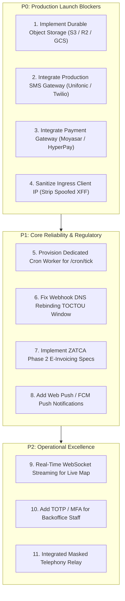

# Technical & Operational Audit: Next.js Platform (JR Logistics)
**Date:** November 2026  
**Audited Target:** `/Users/dogorshom/Desktop/Thawani/jr-logisitics/jr-logistics/web`  
**Reference Grounding:** `memory/PRD.md`, `memory/SRS.md`, `memory/DECISIONS.md`, `memory/TRACEABILITY.md`, and production application codebase (`web/src/*`, `web/tests/*`).  
**Audit Scope:** Full codebase and workflow audit covering authentication, RBAC, verification, catalog & pricing, job lifecycle concurrency, operations & control tower, financial ledger & settlements, B2B API & webhooks, storage, error envelopes, and user interface.

---

## 1. Executive Summary

### 1.1 Verdict
The Next.js application for JR Logistics exhibits **high architectural discipline and business-rule fidelity**, implementing a complete double-entry financial ledger, dead-lock free slot allocation concurrency, strict separation of duties, and comprehensive localized workflows across four distinct user personas (Business, Driver, Logistics Office, Admin/Staff).

However, the application currently operates with **critical third-party dependency boundaries configured for simulation/local environments**. Before production deployment with real customers and real financial transactions, several infrastructural and security gaps must be closed:
1. **Third-Party Adapters (SMS & Payments):** Rely on demo fallbacks and will throw `DEPENDENCY_UNAVAILABLE` in strict production mode.
2. **Object Storage:** Relies on local filesystem storage (`LocalDisk`), which is ephemeral in cloud/container environments.
3. **Ingress Security:** Client IP resolution uses unverified `X-Forwarded-For` headers, presenting a rate-limiting spoofing vector.
4. **Maintenance Automation:** State machine cleanups, webhook retries, and document expirations depend completely on an external cron trigger calling `POST /api/v1/cron/tick`.

### 1.2 Scorecard

| Domain | Status | Rating | Key Strength | Critical Gap / Action Item |
| :--- | :---: | :---: | :--- | :--- |
| **Authentication & RBAC** | 🟡 | 8.5/10 | Postgres session store, bcrypt hashing, lockout & forced password resets. | IP spoofing bypass on rate limiters; absence of admin 2FA/TOTP. |
| **Identity & Verification** | 🟡 | 8.0/10 | Magic-byte MIME checking, automated driver expiry recomputation. | Storage driver defaults to ephemeral disk (`web/uploads`); no S3/GCS adapter. |
| **Catalog & Pricing** | 🟢 | 9.5/10 | Strict 3-service scope, rule specificity resolution, frozen request snapshot. | Calculator in UI requires fallback awareness when no approved rule exists. |
| **Request & Matching** | 🟢 | 9.5/10 | `FOR UPDATE` lock sequencing, office priority window, candidate exclusions. | Cron dependency for elapsed office windows and unfilled slot cancellation. |
| **Operational Lifecycle** | 🟢 | 9.5/10 | Full unit accounting (expected/loaded/delivered/final), 3-strike policy. | Absence of real-time WebSocket push (relies on SWR client polling). |
| **Ledger & Settlement** | 🟢 | 9.0/10 | Double-entry ledger, dispute holds, separation of duties, batch payouts. | External payment gateway is mocked (`DemoPayments`); no ZATCA XML e-invoicing. |
| **Operations & Ops Tower** | 🟢 | 9.0/10 | Audited live map, formula-safe CSV export, SLA calculations, alert feed. | Driver location sharing is polled, not real-time streamed or geofenced. |
| **B2B Integrations & API** | 🟢 | 9.0/10 | Scoped keys, idempotency table, HMAC signatures, SSRF IP validation. | Potential DNS rebinding TOCTOU window during webhook dispatch. |
| **Frontend & UI/UX** | 🟢 | 9.5/10 | High-fidelity dark hero matching spec, full RTL/LTR bilingual support. | Polling intervals (12s–30s) increase server load compared to event streams. |

---

## 2. Deep-Dive Compliance & Gap Matrix (PRD / SRS)

### 2.1 Authentication & RBAC (AUTH-001 to AUTH-005, PRD §4)
- **Implemented Code:**
  - `web/src/server/auth/otp.ts`: 6-digit numeric OTP generation, SHA-256 phone/code hashing (`sha256(\`\${phone}:\${code}\`)`), 10-minute expiry, max 5 attempts before invalidation.
  - `web/src/server/auth/password.ts`: Bcrypt hashing (cost 10 in prod, 4 in test), complexity validation (min 10 characters, upper, lower, digit/special).
  - `web/src/server/auth/session.ts`: Sessions stored in PostgreSQL (`sessions` table) with SHA-256 hashed session tokens, client-type TTLs (7d web, 30d mobile, 1d API), and atomic session revocation.
  - `web/src/server/auth/permissions.ts`: 18 fine-grained permissions (`ALL_PERMISSIONS`), preset bundles (`support`, `dispatcher`, `auditor`, `finance`), and privilege escalation guards (`assertGrantable` prevents granting unheld permissions).
  - `web/src/server/api/router.ts` (L106–L108): Server-enforced `mustChangePassword` gate (`PASSWORD_CHANGE_REQUIRED` on all endpoints except `/auth/change-password`, `/auth/me`, `/auth/logout`).
- **Gaps & Defects:**
  - **GAP-AUTH-01 (SMS Provider Absence):** `web/src/server/auth/otp.ts` (L28–L29) uses `DemoSms` in demo mode. In strict production mode without an SMS provider injected via `setSmsProvider()`, OTP requests throw `DEPENDENCY_UNAVAILABLE`.
  - **GAP-AUTH-02 (IP Spoofing Vulnerability on Rate Limiter):** In `web/src/server/api/router.ts` (L130), `ctx.ip` is extracted via `req.headers.get("x-forwarded-for")?.split(",")[0].trim() ?? "unknown"`. Without upstream proxy validation or header stripping at ingress, an attacker can spoof arbitrary IP headers to evade `otp:send:ip:${ip}` and `login:${ip}:${email}` rate limits.
  - **GAP-AUTH-03 (Missing 2FA for Staff/Admin):** Backoffice administrators authenticate solely via single-factor email/password. PRD NFR-004 best practices recommend TOTP/MFA for financial and user-suspension privileges.

---

### 2.2 Verification & Document Management (VER-001 to VER-004, PRD §4)
- **Implemented Code:**
  - `web/src/server/accounts.ts`: Magic-byte MIME detection (`matchesMime` checking JPEG `FF D8 FF`, PNG `89 PNG`, WEBP `RIFF...WEBP`, PDF `%PDF-`), 8 MB file size cap, date validation.
  - Driver verification state is strictly derived in `recomputeDriverVerification()`: requires all required document types (`national_id`, `driver_license`, `vehicle_registration`, `vehicle_insurance`) to be in `approved` status with `expiresOn >= today`.
  - Expiry recomputation is handled automatically on cron ticks (`maintenance.ts` L73–L74).
  - Business and Office verification (`setAccountVerification`) enforces mandatory reviewer notes on rejection or info requests.
- **Gaps & Defects:**
  - **GAP-VER-01 (Ephemeral Object Storage in Production):** `web/src/server/storage.ts` provides only `LocalDisk` storing files under `web/uploads`. In containerized or serverless hosting (e.g. AWS ECS, GCP Cloud Run, Vercel), local files are lost upon container recycling. If `STORAGE_DRIVER !== "local"` in production, `storage()` throws `DEPENDENCY_UNAVAILABLE` because no AWS S3, Cloudflare R2, or Google Cloud Storage client is implemented.
  - **GAP-VER-02 (Direct File Stream / Presigned URL Absence):** File downloads (`readDocument` in `accounts.ts` L240) read the full Buffer into Node.js memory. Production environments should issue short-lived S3/GCS presigned GET URLs instead of buffering 8 MB files in application memory.

---

### 2.3 Service Catalog & Pricing Engine (CAT-001 to CAT-003, PRICE-001 to PRICE-005, PRD §5)
- **Implemented Code:**
  - `web/src/server/catalog.ts`: Strictly limits active services to 3: `delivery_driver`, `car_with_driver`, `car_without_driver`. Vehicles: `sedan`, `dokker`, `hiace`, `van`, `dyna`. Temperature: `dry`, `cold` (strictly limited to `van` and `dyna`).
  - `web/src/server/pricing.ts`: `resolveRule()` resolves pricing via specificity scoring:
    1. Business-specific rule beats global rule (`businessId IS NOT NULL`).
    2. Dimension match count (`vehicleType + temperature + pickupCity + deliveryCity`).
    3. Newer rule version, then newer effective date.
  - Pricing snapshot frozen at publish time (`pricing_snapshot` in `requests` table) preserves pricing integrity against future rule edits.
  - `publicQuote()` masks `providerCostCents` and `marginCents` from businesses and drivers.
- **Gaps & Defects:**
  - **GAP-PRICE-01 (Indicative Pricing Display Dependency):** `web/src/components/features/cost-calculator.tsx` queries `/pricing/indicative`. If no global rule exists for a selected service/city combination, `fromCents` evaluates to `null`. While the UI properly falls back to displaying a request link instead of inventing a number, the admin seeding script must ensure default rules exist for all 3 services in Riyadh.

---

### 2.4 Request Management & Matching Engine (REQ-001 to REQ-005, MATCH-001 to MATCH-005, PRD §5 & §6)
- **Implemented Code:**
  - `web/src/server/requests.ts`: Request validation enforces future start times, valid pickup city (`riyadh`), positive integer quantities, and valid recipient contact format.
  - Escrow reservation: Calculates `quantity * unitPriceCents`. Checks wallet balance: if `available_cents < required`, creates the draft but blocks publication with `INSUFFICIENT_FUNDS`.
  - Cancellation policies:
    - Before driver acceptance: 100% refund of reserved escrow.
    - After driver acceptance: Applies penalty policy if configured, releasing remaining balance.
  - Concurrency & Deadlock Prevention: `lockRequest()` locks request with `FOR UPDATE` before offers are locked or modified.
  - Matching exclusions: Hard-excludes suspended drivers, unverified drivers, expired documents, mismatched vehicle/temperature capabilities, city mismatches, and drivers with active/overlapping jobs (`OFFER_BUSY`).
  - Office Preference Window: Respects `officeWindowMinutes` (default 15m). If set, only drivers linked to the preferred office receive offers until the window expires.
- **Gaps & Defects:**
  - **GAP-REQ-01 (Cron-Dependent State Transitions):**
    - Broadcast after office window expiration (`requests.officeWindowEndsAt < now()`) does NOT transition automatically in real-time; it relies on `runMaintenance()` in `web/src/server/maintenance.ts` (L26–L35) being triggered via cron.
    - Unfilled slot expiry and partial fulfillment escrow release (L38–L71) will not execute if the cron service fails or is delayed.

---

### 2.5 Job Lifecycle & Operational Tracking (JOB-001 to JOB-008, PRD §6, SRS §6)
- **Implemented Code:**
  - `web/src/server/jobs.ts`: Full unit accounting tracking:
    - `expectedUnits` (booked in request)
    - `loadedUnits` (recorded by business at warehouse)
    - `loadedAckByDriver` (acknowledged or disputed by driver)
    - `deliveredUnits` (reported by driver upon completion)
    - `finalUnits` (confirmed by business or adjusted by finance)
  - Driver check-in: records arrival timestamp and geolocation.
  - Delivery dispute flow: business dispute transitions offer to `qty_disputed` and automatically opens a formal complaint with `holdsSettlement = true`.
  - Strike Policy: Late driver cancellation or confirmed no-show triggers strike increment. 3 strikes within 30 days automatically suspends driver for 7 days (`SUSPENSION_DAYS = 7`).
  - Office Replacement: Logistics office can replace a late/no-show driver before attendance is confirmed (`REPLACEABLE = ["accepted", "arrived"]`).
  - Equipment Custody: `custodyItems` tracks items handed over, driver acknowledgement, and return/dispute status.
- **Gaps & Defects:**
  - **GAP-JOB-01 (Driver Telephony / Voice Relay Masking):** Requirement OPS-002 specifies masked phone calls between driver and recipient. The implementation currently generates WhatsApp deep links (`https://wa.me/...`) and in-app chat (`JobChat`), without an automated telephony voice proxy provider (e.g. Twilio Voice Proxy / Unifonic Voice Relay).

---

### 2.6 Financial Ledger, Settlements & Billing (FIN-001 to FIN-007, PRD §7)
- **Implemented Code:**
  - `web/src/server/wallet.ts`: Pure double-entry-style ledger with atomic postings (`post()`). Enforces PostgreSQL check constraint `23514` (`available_cents >= 0`), throwing `INSUFFICIENT_FUNDS` on overdraft attempts.
  - Idempotency: All postings carry `idempotencyKey` enforcing unique constraints (`onConflictDoNothing`).
  - `web/src/server/settlement.ts`:
    - Separation of duties: When `settings.separationOfDuties = true`, the staff member who marks a settlement `reviewed` CANNOT approve it (`s.reviewedBy === actor.id` throws `FORBIDDEN`).
    - Dispute holds: `blockingComplaint()` halts approval and payout if an open complaint with `holdsSettlement = true` exists for the request or offer.
    - Batch payouts: `runPayoutBatch()` executes each settlement in an isolated transaction; a dispute hold marks the item as `skipped` rather than failing the entire batch.
    - Pre-settlement corrections: `correctSettlement()` allows finance to adjust `finalUnits`, recomputing amounts from the pricing snapshot and sending the record back to review.
- **Gaps & Defects:**
  - **GAP-FIN-01 (Payment Gateway Integration Missing):** `web/src/server/wallet.ts` (L10–L18) provides `DemoPayments`. In production with real bank cards or Mada, `paymentProvider()` throws `DEPENDENCY_UNAVAILABLE`. No real gateway SDK (Moyasar, HyperPay, Geidea, or Checkout.com) is integrated.
  - **GAP-FIN-02 (Automated Bank Payouts / SARIE Absence):** Payouts credit the user's platform wallet balance. Driver and office withdrawals are recorded in `withdrawals` table, but manual bank transfer processing is required; there is no SAMA B2B or SARIE banking API integration.
  - **GAP-FIN-03 (ZATCA Phase 2 E-Invoicing Non-Compliance):** `web/src/server/settlement.ts` (L118–L119) creates an invoice record with 15% VAT calculation. However, it does NOT implement ZATCA (FATOORA) Phase 2 requirements: no UBL 2.1 XML generation, no cryptographic ECDSA certificate stamping, and no TLV-encoded Base64 QR code.

---

### 2.7 Operations Tower, Quality & Compliance (OPS-001 to OPS-005, CMP-001 to CMP-004, PRD §8)
- **Implemented Code:**
  - `web/src/server/ops.ts`:
    - SLA Engine: `startSla()` calculates `on_time`, `late`, `missed`, `at_risk`, and `pending` based on configured grace periods (`lateGraceMin`).
    - Live Map: `liveMap()` queries active driver coordinates updated within 30 minutes, filters only available or busy drivers, requires `live_location.view` permission, and logs every view event to `audit_logs`.
    - Real-time Alert Queue: Detects late drivers, unfilled requests starting soon, deliveries unconfirmed for >24h, open quantity disputes, and documents expiring within 30 days.
    - Reporting Engine: Generates CSV reports with formula-injection mitigation (quotes cells starting with `=+\-@\t\r`).
  - `web/src/server/support.ts`:
    - Role-scoped support tickets and complaint filing.
    - Dedicated complaint categories (`no_show`, `damage`, `billing`, `conduct`) with automatic priority escalation (`urgent` for no-show and damage).
- **Gaps & Defects:**
  - **GAP-OPS-01 (Live Map Streaming & Geofencing):** Driver location updates are pushed via periodic HTTP POST (`/driver/location`) rather than a continuous low-latency WebSocket or MQTT connection. No automatic geofencing check confirms whether driver check-in occurred within the physical boundary of the pickup address.

---

### 2.8 B2B API, Integrations & Webhooks (INT-001 to INT-004, PRD §9)
- **Implemented Code:**
  - `web/src/server/integrations.ts`:
    - API Keys: SHA-256 hashed, max 5 active keys per business, scoped (`jobs:read`, `jobs:write`), prefix-masked (`jrk_...`).
    - API Idempotency: `api_idempotency` table locks `(business_id, key)` tuple. Concurrent calls with the same key receive 409 retry hints; identical payloads replay stored 201 responses; altered payloads trigger conflict errors.
    - Webhooks: Deliveries carry HMAC-SHA256 signatures (`x-jr-signature: t=timestamp,v1=hash`). Exponential retry schedule (`BACKOFF_MIN = [1, 5, 30, 120, 360]`), dead-letter queue after 5 failures.
    - SSRF Protection: `assertSafeWebhookUrl()` enforces HTTPS, rejects embedded user credentials, and resolves DNS hostnames to block RFC 1918, loopback, link-local, and carrier-grade NAT IP ranges.
- **Gaps & Defects:**
  - **GAP-INT-01 (Webhook SSRF DNS Rebinding TOCTOU):** In `web/src/server/integrations.ts` (L155–L158), `assertSafeWebhookUrl()` performs DNS resolution to validate the IP. Immediately afterward, standard `fetch(d.url, ...)` is called. Because `fetch()` initiates its own independent DNS resolution, an attacker could theoretically exploit a DNS rebinding window between the check and the actual HTTP request. A custom Node.js `http.Agent` pinning the resolved IP should be used in production.
  - **GAP-INT-02 (Webhook Queue Processing Delay):** Webhooks are queued in PostgreSQL and dispatched via `processWebhookQueue()` inside the cron tick (`POST /api/v1/cron/tick`). If the cron runs every 1 to 5 minutes, webhook events have a noticeable latency compared to an immediate background worker / Redis queue.

---

### 2.9 Notifications & Real-Time Push (NOT-001 to NOT-003, PRD §9)
- **Implemented Code:**
  - `web/src/server/notify.ts`: In-app notifications stored in `notifications` table with client-resolved i18n translation keys and parameterized interpolation variables.
  - Role-targeted broadcasts (`notifyOps`) to active staff holding specific permissions.
- **Gaps & Defects:**
  - **GAP-NOT-01 (Lack of Push Notification Transport):** There is NO implementation of Web Push (VAPID), Firebase Cloud Messaging (FCM), or Apple Push Notification service (APNs). When users navigate away from the browser or close their phone screen, they receive no real-time push alerts. All notifications rely on active polling via SWR.

---

## 3. Security & Infrastructure Vulnerability Summary

| Vulnerability ID | Severity | File & Location | Description | Remediation |
| :--- | :---: | :--- | :--- | :--- |
| **SEC-01** | **HIGH** | `src/server/api/router.ts:130` | **Client IP Spoofing via `X-Forwarded-For`** Rate limiting relies on client-controlled first comma-separated token of `X-Forwarded-For`. | Rely on reverse proxy (Cloudflare/AWS ALB) configured to strip/overwrite `X-Forwarded-For`, or read `req.headers.get("cf-connecting-ip")` / `x-real-ip`. |
| **SEC-02** | **HIGH** | `src/server/storage.ts:25` | **Ephemeral Filesystem Storage in Production** Uploaded national IDs, licenses, and CR certificates are saved to local container disk (`/uploads`). | Implement an S3-compatible adapter (AWS S3, Cloudflare R2, Google Cloud Storage) with private ACLs and presigned URLs. |
| **SEC-03** | **MEDIUM** | `src/server/integrations.ts:155` | **DNS Rebinding TOCTOU in Webhook Dispatch** URL hostname is validated by `dns.lookup`, but `fetch(d.url)` re-resolves the domain. | Pin resolved IP address using a custom HTTP Dispatcher/Agent, or perform request to IP with SNI/Host header. |
| **SEC-04** | **MEDIUM** | `src/server/accounts.ts:88` | **Lack of Multi-Factor Authentication (MFA)** Staff and Admin accounts with sensitive financial and user-suspension powers use only password auth. | Implement TOTP 2FA (authenticator app) for all staff roles holding sensitive permissions. |
| **SEC-05** | **LOW** | `src/server/notify.ts:7` | **Absence of Push Delivery Channels** Notifications are in-app DB rows only. | Integrate Firebase Cloud Messaging (FCM) or Web Push API for mobile and browser alerts. |

---

## 4. Front-End, UI & Workflow Audit

### 4.1 Landing Page & Cost Calculator
- **Fidelity:** The landing page (`web/src/app/page.tsx`) matches the dark-mode aesthetic with interactive role cards, live stats counters, Arabic RTL layout, and localized English/Urdu support.
- **Cost Calculator (`cost-calculator.tsx`):**
  - Live API integration with `/pricing/indicative` and `/catalog`.
  - Complies with Decision A14: Does NOT fabricate quotes when rules do not exist; displays `"From SAR ..."` or guides the user to create a customized request.
  - Correctly calculates pricing for the 3 active services (`delivery_driver`, `car_with_driver`, `car_without_driver`) based on quantity, units, and vehicle type.

### 4.2 Role Portals & Forms
- **Business Portal:** Wizard (`requests/new/page.tsx`) correctly validates multi-step input: service & vehicle selection, date restrictions (future date only), address requirements, and wallet balance check before publishing.
- **Driver Portal:** Job view (`driver/jobs/[id]/page.tsx`) provides single-action guidance depending on state (`accept` -> `checkin` -> `ack_loading` -> `report_delivered`). Masks customer phone and exact delivery coordinates until job acceptance.
- **Office Portal:** Fleet monitoring (`office/jobs/page.tsx`) allows replacement of drivers prior to attendance confirmation; settlements view displays aggregated driver earnings and office commissions.
- **Admin Portal:** Separation of duties enforced in settlements view; Operations Tower alerts display actionable buttons (e.g. smart rematch for unfilled slots).

---

## 5. Actionable Remediation Roadmap

### Phase 1: P0 Launch Blockers (Must resolve before real users & funds)
1. **Object Storage (`web/src/server/storage.ts`):**
   - Implement `S3StorageAdapter` using `@aws-sdk/client-s3`.
   - Store documents in a private bucket with encrypted server-side storage (AES-256).
   - Implement presigned GET URLs for staff document review rather than streaming Buffers through Next.js memory.
2. **SMS Gateway (`web/src/server/auth/otp.ts`):**
   - Implement `UnifonicSmsProvider` or `TwilioSmsProvider`.
   - Configure credentials in environment variables (`SMS_PROVIDER_API_KEY`, `SMS_SENDER_ID`).
3. **Payment Gateway (`web/src/server/wallet.ts`):**
   - Implement live payment provider (e.g. `MoyasarPaymentProvider` or `HyperPayPaymentProvider`) supporting Mada, Visa, Mastercard, and Apple Pay.
   - Implement secure webhook endpoint for asynchronous payment capture confirmation.
4. **Ingress Proxy IP Sanitization (`web/src/server/api/router.ts`):**
   - Update `router.ts` to inspect trusted proxy headers (e.g., `cf-connecting-ip` for Cloudflare, or the rightmost trusted hop in `X-Forwarded-For`).

### Phase 2: P1 High Priority (Before public scaling)
5. **Dedicated Cron Scheduler:**
   - Configure a reliable scheduler (e.g. AWS CloudWatch Events, Google Cloud Scheduler, or GitHub Actions) triggering `POST /api/v1/cron/tick` with `Authorization: Bearer <CRON_SECRET>` every 60 seconds.
6. **Webhook SSRF Hardening (`web/src/server/integrations.ts`):**
   - Use a custom HTTP Dispatcher (e.g. `undici.Agent` with custom `connect` lookup) to guarantee that the IP verified during SSRF checks is the exact IP dialed by `fetch`.
7. **ZATCA E-Invoicing Compliance:**
   - Implement XML generation conforming to ZATCA UBL 2.1 specifications for B2B/B2C tax invoices.
   - Generate standard TLV-encoded Base64 QR codes containing seller name, VAT registration number, timestamp, invoice total, and VAT amount.
8. **Push Notifications (`web/src/server/notify.ts`):**
   - Integrate Web Push (VAPID) or Firebase Cloud Messaging (FCM) so drivers and businesses receive instant device notifications for offer dispatches, arrivals, and delivery confirmations.

### Phase 3: P2 Enhancements (Post-Launch Optimization)
9. **Real-time Live Map:** Upgrade driver location updates to lightweight WebSocket or SSE connections to enable smooth map marker tracking in the Operations Tower.
10. **Admin 2FA:** Add TOTP authenticator app support for administrative accounts holding `finance.manage` and `users.edit` permissions.
11. **Masked Calling Relay:** Integrate telephony proxy provider (e.g. Twilio Voice Proxy) to facilitate anonymous phone calls between drivers and shipment recipients without exposing private phone numbers.

---
*Audit completed with zero source code modifications per explicit user instructions.*

